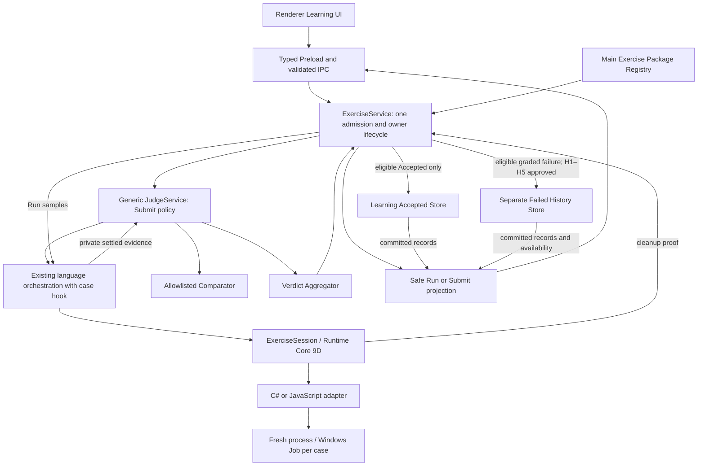

# Phase 9E — Judge & Submit Architecture Review and Design

Date: 2026-10-23. Assessment: **SUITABLE WITH CHANGES**.

Document status: **APPROVED DESIGN — 9E-0 COMPLETE**, 2026-10-23. All six
architecture decisions and ten decisions9E0-A1–A4/B1–B3/C1–C3 are approved in
[ADR-025](DECISIONS.md#phase-9e-0--approved-judge-and-submit-decisions-2026-10-23),
with numerical policies in [A/B/C specification](PHASE-9E0-REMAINING-DECISIONS.md).
At design approval, Phase9E/9E-1 were NOT_STARTED. Subsequent explicit authorization
covers Steps1/2 (accepted COMPLETE), then Step3 implemented under APPROVED
S3-D1–D4: accepted COMPLETE — PASS WITH LIMITATIONS.
Step4 COMPLETE — PASS WITH LIMITATIONS by formal user acceptance under APPROVED S4-D1/D2;
Steps1–4 accepted COMPLETE — PASS WITH LIMITATIONS; Step5 COMPLETE — PASS WITH
LIMITATIONS (Current Host Only), S5-AC1. **Phase9E-1 COMPLETE — PASS WITH
LIMITATIONS**, user approval9E1-AC1; [phase closure](PHASE-9E1-FINAL-ACCEPTANCE.md#9-official-phase9e-1-closure).
Both target hosts UNVERIFIED/mandatory before9E-7/release; retained Runtime,
full-app/filesystem/installed limits; SDK prototype NOT PASS — excluded from
production. Phase9E IN_PROGRESS;9E-2 NOT_STARTED, not authorized.
See [Step4 evidence](PHASE-9E1-STEP4-MIGRATION-BOUNDED-IPC.md)
and [Step3 evidence](PHASE-9E1-STEP3-LAZY-REGISTRY-READINESS-BUDGETS.md)
for the actual registry/accounting/lifecycle, and
[Step2 report](PHASE-9E1-STEP2-RESOURCE-INTEGRITY-ASSETS.md) for actual modules;
later NOT_STARTED/no-implementation statements below record the design baseline,
not the current status of accepted Steps1–5.9E-2 is not authorized. S4-D1/D2 are
APPROVED: explicit4-public-asset/version2 staging plus owned public acquisition;
full5-asset validation and official owned Prepare semantics remain unchanged.
**APPROVED design** is distinct from **PROPOSED implementation**: new modules,
schema examples and APIs below do not exist unless explicitly identified as
existing. Sections marked PROPOSED describe implementation form, not undecided
approved policy. Performance targets are **NOT MEASURED**, implementation acceptance
**UNVERIFIED**; no tests/benchmarks are implied PASS by this approval.

Later APPROVED Submission History amendment supersedes the baseline product
restriction to Accepted history; [Section16](#16-approved-h1h5--submission-history)
defines approved scope and separately PROPOSED Failed implementation form. Accepted policies
are unchanged. Baseline9E-0 remains COMPLETE, H1–H5 policy gates are resolved;
package asset/parser L1–L12 are now APPROVED in the separate specification.

Step2 amendment: S2-R1–R4 are APPROVED in
[ADR-025](DECISIONS.md#phase9e-1-step2--s2-r1r4-approved-2026-10-23) and the
[Step2 contract](PHASE-9E1-STEP2-RESOURCE-INTEGRITY-ASSETS.md#2-approved-contract-selections).
Concrete roots, compiled anchor, canonical signature v1, strict link/identity
checks/Node TOCTOU limitations and explicit bootstrap supersede the earlier
unspecified implementation forms. Approval is not resource/packaging acceptance.

Step3 amendment: all recommended S3-D1–D4 contracts are APPROVED in
[ADR-025](DECISIONS.md#phase9e-1-step3--s3-d1d4-approved-2026-10-23) and the
[Step3 specification](PHASE-9E1-STEP3-LAZY-REGISTRY-READINESS-BUDGETS.md#2-approved-precise-contracts).
Exact reservation/ownership, leases/BUSY/retry, capability states and tracked
startup/retained shutdown apply without altering L/S2/Runtime policy. This amendment
covered Step3 only; subsequent Step4 authorization and its staging gate are noted above.

## 1. Goal, scope and decision baseline

The approved direction, extended by H1–H5: **Exercise Package + Generic Judge Engine +
Learning Runtime 9D + Comparator + Verdict Aggregator + Submission Persistence
(Accepted + eligible graded failures)**.
It fits the existing Main-owned Learning domain without replacing its lifecycle.

Already accepted requirements, retained unchanged:

- Function-signature exercises; C# and synchronous JavaScript; six value types.
- Main chooses official public/hidden tests; 100% must pass for Accepted.
- Run never saves Accepted records or completes an exercise.
- Immutable code-at-Submit; multiple submission versions. Later approved amendment
  adds trustworthy graded-failure history separately from Accepted Storage (Section16).
- Saved/new completion follows successful persistence, not judging alone.
- One global Learning operation, no queue; Project Run and PTY remain separate.
- Runtime Core, native, Policy B, deadlines and quotas remain unchanged.
- Run/Submit UI only; Stop/Cancel remain internal lifecycle capabilities.

Authority: [Requirements, Phase 9](REQUIREMENT.md#phase-9--learning--programming-techniques),
[Architecture, Exercise/Judge boundary](ARCHITECTURE.md#exercise-judge-and-runtime-boundary),
[ADR-025](DECISIONS.md#adr-025--phase-9-learning-and-function-based-exercises),
[Plan 9E](IMPLEMENTATION-PLAN.md#9e--local-judge--submit),
and [accepted 9D final review, Section 8](PHASE-9D-FINAL-REVIEW.md).
ADR-020/021 ownership/fail-closed cleanup and ADR-018 testing guidance remain
constraints; broader renderer state is not resolved here through ADR-011.
P9-HARNESS comparison and P9-STORAGE policies listed in9E-0 are approved design;
implementation, exact executable schemas and acceptance evidence remain due.

Current authorization is documentation finalization only: synchronize authority
and design records, close 9E-0 and stop. No code/tests/scripts/catalogue edits,
test authoring/migration, generators/oracles, runtime changes or benchmarks.
Custom Run is deferred; ProductExceptSelf sample correction is approved for later
authorized implementation, not performed here. Runtime/Core/native/Policy B stay.

## 2. Repository compatibility and evidence

This table records the pre-implementation inspection. Step4 actual paths and
migration evidence supersede its source-location observations; see the
[Step4 report](PHASE-9E1-STEP4-MIGRATION-BOUNDED-IPC.md). The legacy catalogue is now
a parity fixture; production data comes from the anchored package Registry.

Paths in this table exist and were read. Links name the implementing symbol;
the proposed module table in Section 3 must not be read as an actual code map.

| Existing source / symbol | Observed behavior | Consequence for design |
|---|---|---|
| [content/exercises.ts](../src/main/services/learning/content/exercises.ts), `chapters`, `exercises` | 63 exercises, chapters 2–8, nine/chapter; two samples each; IDs generated from row position; final guard requires exactly 63 | Preserve existing IDs, order, source metadata and public samples during migration; stop generating identity from position |
| [practice.ts](../src/shared/contracts/practice.ts), `Exercise`, `ExerciseTest` | Signature, starters and public samples share one DTO; sample includes args/expected | Keep this public projection separate from Main-only official package data |
| Same file, `isExerciseId`, `isPracticeState`, `isExercise`, `isPracticeLoad` | IDs match `ch[2-8]-0[1-9]`; limits 126 drafts/63 language selections; load requires exactly 63; chapter inferred from ID character | Generic Judge alone cannot enable exercise 64; migrate contracts/catalogue limits once, preserve old keys |
| [practice-content.test.ts](../tests/main/practice-content.test.ts) | Asserts 63, 3/difficulty/chapter and two samples; checks typed values, not algorithm correctness or textual constraints | Retain a legacy migration fixture; future generic validation must not require these cardinalities |
| [practice-ipc-service.ts](../src/main/ipc/practice-ipc-service.ts), `start()` | `practice:load` returns the complete existing `exercises` array; save checks membership | Never append hidden data to that array; project public fields explicitly |
| [practice-store.ts](../src/main/services/learning/practice-store.ts), `savePracticeDraft()` | Versioned draft/language state using `PersistenceService.updateWith()` | Preserve drafts independently from Accepted; no completion derived from draft presence |
| [exercise-service.ts](../src/main/services/learning/exercise-service.ts), `run`, `execute`, `cleanup`, `invalidate`, `beginShutdown` | One active operation; owner/generation, startup recovery, retained cleanup and stale suppression; clears active after execution/cleanup | Extend this coordinator for Submit and storage settlement; do not add another admission manager |
| Same file, `createWindowsExerciseService()` | Both factories look up catalogue samples and expose language-specific observations | Add trusted operation mode/case-plan selection and distinct public Submit projection |
| [csharp-execution-adapter.ts](../src/main/services/learning/runtime/csharp-execution-adapter.ts), constructor/`execute()` | Clones Exercise; derives schema/count from samples; uses sample args; prepares once, compiles once, new process per case | Narrow case-source/signature refactor is necessary; compiler/Job lifecycle stays |
| [javascript-execution-adapter.ts](../src/main/services/learning/runtime/javascript-execution-adapter.ts), constructor/`execute()` | Same sample coupling; separate Node probe/syntax; new Node Job per case; result envelopes bounded | Same refactor, preserving existing JavaScript contract and ordering |
| [csharp-orchestrator.ts](../src/main/services/learning/runtime/csharp-orchestrator.ts), `runCsharpSamples()` | Claims exact session/adapter; Prepare → compile → VERIFIED barrier → case/barrier loop → close | Reuse phase driver; add bounded case-consumer/stop policy rather than a second loop in Judge |
| [javascript-orchestrator.ts](../src/main/services/learning/runtime/javascript-orchestrator.ts), `runJavascriptSamples()` | Additional barrier after Prepare/probe, then syntax/barrier and case/barrier loop | Preserve language-specific barrier order; do not force identical phase sequences |
| [csharp-harness.ts](../src/main/services/learning/runtime/csharp-harness.ts), `generateCsharpHarness()` | Uses signature/count; expected values are not embedded; count tied to samples | Accept a validated execution descriptor/count through a compatibility layer |
| [javascript-harness.ts](../src/main/services/learning/runtime/javascript-harness.ts), `FixedJavascriptHarness` | Source file contains code/function/schema; `request()` takes sample args | Decouple request inputs; keep fixed child asset, source identity/hash checks and strict protocol |
| [exercise-session.ts](../src/main/services/learning/runtime/exercise-session.ts), `claimOrchestration`, `runPhase`, `verifyExecutionBarrier`, `close`, `classifyExerciseTermination` | Sole Core phase/Job/checkpoint cleanup authority; finalization can be HISTORY_UNVERIFIED | Judge has no independent process ownership; finished alone cannot justify Accepted |
| [exercise-limits.ts](../src/main/services/learning/runtime/exercise-limits.ts), `ExerciseLimits` | Monotonic operation deadline, phase clamp, retained barrier/cleanup waits | Compare before closing the runtime budget; no new timer/reset per batch |
| [exercise-recovery.ts](../src/main/services/learning/runtime/exercise-recovery.ts), `recoverExercise()` | Validates checkpoint under lease; quarantines unresolved/history states; never adopts PIDs | Runtime recovery remains separate from recovering Accepted storage; checkpoint is not a verdict |
| [exercise-ipc-service.ts](../src/main/ipc/exercise-ipc-service.ts), `boundary`, `publish` | Sender/frame/epoch/session/generation/sequence guards and safe DTO validation | Reuse authorization and routing rules, with Submit-specific DTO; old snapshot endpoints must not leak Submit evidence |
| [preload/bridge/exercise.ts](../src/preload/bridge/exercise.ts), `createExerciseBridge()` | Validates invoke/event payloads; buffers early events; rejects stale generation/context; removes listeners | Add semantic Submit transport, maintain cross-Run/Submit ordering and lifecycle cleanup |
| [PracticeWorkspace.tsx](../src/renderer/src/features/learning/practice/PracticeWorkspace.tsx) | Submit disabled; `solutions={[]}`; list label hardcodes nine and three/difficulty | Wire later; data-driven counts required for exercise 64; preserve visual language |
| [PracticeTestPanel.tsx](../src/renderer/src/features/learning/practice/PracticeTestPanel.tsx) | Shows sample expected/actual/console, binds schema to public sample count; does not compare | Keep sample view for Run; do not feed official evidence to this component |
| [use-exercise-runtime.ts](../src/renderer/src/features/learning/practice/use-exercise-runtime.ts), [use-practice.ts](../src/renderer/src/features/learning/practice/use-practice.ts) | Captures source revision, context identity; edits/drafts and source replacement isolated | Submit takes one immutable capture; later edits do not replace submitted code |
| [MySolutions.tsx](../src/renderer/src/features/learning/practice/MySolutions.tsx) | Presentation-only Accepted/saved filter; explicit Restore confirmation | Main must supply committed records; UI filtering is not proof of persistence |
| [persistence-service.ts](../src/main/services/persistence/persistence-service.ts), `updateWith`, `writeDocument`, `load` | Serialized updates, clone/validate, temp write, backup copy, rename; in-memory value changes after success; primary/backup/default recovery | Useful baseline but not a verified durable Accepted transaction; details in Section 11 |
| [main/index.ts](../src/main/index.ts) | Composes Practice store, Exercise service, IPC, owner observation and shutdown | Additive Learning integration only; service registration/shutdown order must cover pending commit |

Evidence limitations: 9D closure is scoped Windows 11 installed-runtime acceptance,
not a fresh Windows 10/UNC/packaged PASS. Seven tracked JavaScript evidence reports
were already deleted in the working tree when this review began:
`PHASE-9D2-JAVASCRIPT-{ACCEPTANCE,FINAL-REVIEW,HARNESS-SYNTAX,ORCHESTRATOR,PLAN,UI-IPC}.md`
and `PHASE-9D2-NODE-RESOLVER-PROBE.md`. Those deletions are unrelated and untouched.
The surviving final review and current source were read; unavailable linked
reports are not claimed as independently rechecked. No historical test count is
presented as a test run by this task.

## 3. Architecture and module responsibilities — PROPOSED



| Module / location | Responsibility; explicit non-responsibility |
|---|---|
| `content/exercise-package-registry.ts` | Validate bundled manifest/packages, resolve immutable version; public projection and private test-set access; no dynamic checker execution |
| `judge-service.ts` (already planned path) | Construct official ordered plan, consume private evidence, compare, request fail-fast, aggregate; no session/Job/lease/shutdown subsystem |
| `judge/exact-typed-comparator.ts`, `judge/comparator-registry.ts` | Pure bounded typed equality; Main allowlist by ID/version |
| `judge/verdict-aggregator.ts` | Pure execution/comparison reduction; explicit separate lifecycle/cleanup/storage status |
| Existing `exercise-service.ts` | Single Run/Submit admission, owner lifecycle, same session, publication, cleanup, Accepted commit eligibility and pending-operation settlement |
| Existing language orchestrators/adapters | Own phase sequence and trusted finite input plan; exactly one claim per session; invoke Judge case-consumer after barrier |
| `learning-store.ts` (already planned path) | Main-owned Accepted transaction/read model plus proposed one-target Failed routing and merged history read adapter (Section16); no draft rewrite/process execution |
| `learning/accepted-storage.ts` | Optional Learning-only durable filesystem implementation behind learning-store; only if required by the selected persistence option |
| Shared `judge.ts`, `judge-validation.ts`; narrow Preload/IPC extensions | Public semantic DTOs only; private official set and evidence types stay Main-only |
| Existing Learning UI | Submission status, public sample detail and committed Submission History; no judging authority; component migration proposed in Section16 |

These are logical boundaries, not six independently managed services. Avoid
adding a generic executor, registry plugin system or new renderer state library.
Judge uses the same `Operation` and `ExerciseSession`; it cannot create a second
operation, queue, lease, timeout controller or native cleanup path.

## 4. Run and Submit sequence — PROPOSED

### Run: preserve accepted behavior; comparison is an additive 9E feature

```mermaid
sequenceDiagram
  participant UI as Learning UI
  participant IPC as Preload / IPC
  participant ES as ExerciseService
  participant R as Runtime 9D driver / Core
  participant C as Comparator
  UI->>IPC: Run(exerciseId, language, code, revision)
  IPC->>ES: Validate + authorize sender
  ES->>ES: Admit one operation; capture public sample plan
  ES->>R: Same session, Prepare / compile-or-syntax
  loop Public samples only
    R->>R: Fresh Job execute + required VERIFIED barrier
    R-->>ES: Sample actual or execution failure
    opt 9E sample comparison approved
      ES->>C: Typed actual / Main sample expected
      C-->>ES: PASS / DIFFERENT / invalid evidence
    end
  end
  R->>R: Core close and retained cleanup
  ES-->>IPC: Existing Run evidence + additive sample comparison
  IPC-->>UI: Sample Input / Expected / Actual / errors
  Note over ES,C: No Accepted storage or completion
```

No Run fail-fast on WA is introduced: retain existing sample execution order and
runtime-failure behavior. No custom inputs are introduced by this design.

### Submit: official data never becomes a Run snapshot

```mermaid
sequenceDiagram
  participant UI as Learning UI
  participant IPC as Preload / IPC
  participant ES as ExerciseService
  participant J as JudgeService / Registry
  participant R as Runtime 9D driver / Core
  participant C as Comparator / Aggregator
  participant S as Persistence Router / target Store
  UI->>IPC: Submit(ID, language, code, revision)
  IPC->>ES: Exact validation + sender/frame authorization
  ES->>ES: Admit; issue submission/session identity; freeze source
  ES->>J: Bind installed package / signature / test-set versions
  J->>R: Private ordered inputs, same admitted session
  R->>R: Prepare / compile-or-syntax once
  loop Public first, then hidden; stop on decisive failure
    R->>R: Fresh case Job, execution, VERIFIED barrier
    R->>J: Settled private evidence
    J->>C: Validate and compare with Main expected
    C-->>J: Case decision
    J-->>R: Continue / stop remaining cases
  end
  J->>J: Check operation deadline; provisional aggregate
  R->>R: Core close; retained Policy B cleanup
  R-->>ES: Cleanup proof / pending / failure
  ES->>C: Final lifecycle + cleanup eligibility
  alt All official tests PASS and VERIFIED complete and current
    ES->>S: Guarded idempotent commit of immutable Accepted record
    S-->>ES: Committed / failed / outcome unknown
  else Trustworthy graded failure and approved persistence eligibility
    ES->>S: Immutable failed record to separate Failed store (H1–H5 APPROVED)
    S-->>ES: Saved / failed / pending / unknown; never completion
  else Infrastructure, invalidation, untrusted verdict or unsafe cleanup
    Note over ES,S: No graded-history commit by default; no Accepted commit
  end
  ES-->>IPC: Safe Submit projection only if owner still current
  IPC-->>UI: Verdict + cleanup/storage status; no hidden data
```

Existing orchestrators close before returning final results. Therefore Judge
must consume cases through a pre-close hook, not call `run*Samples()` and try to
fail-fast or check the operation deadline after it already closed. Keep current
Run entry points as compatibility wrappers. The trusted driver remains the sole
caller of `claimOrchestration`, phase methods, barriers and Core close.

## 5. Exercise Package layout and schemas — PROPOSED

### Data and tooling separation

```text
resources/learning/exercises/
  manifest.json
  ch2-01/
    exercise.json           # metadata, statement, constraints, signature
    starters/csharp.txt
    starters/javascript.txt
    samples.json            # public only
    judge/v1.json           # frozen official public + hidden cases
tools/learning-authoring/
  package-validation/       # common authoring schema and release checks
  exercises/ch2-01/         # generator, constraint validator, reference/oracle
  coverage/                 # matrices, mutation cases, provenance reports
src/main/services/learning/
  content/exercise-package-registry.ts
  judge-service.ts
  judge/...
  learning-store.ts
```

All paths above are proposed. No files/packages/tools at these paths are created
by this task. The build must bundle data into Main assets through a trusted
manifest; registry registration/discovery must be generic rather than one import
or switch per exercise. Authoring tools/references are development-only and must
not enter installed runtime assets. No arbitrary filesystem package import,
marketplace, runtime code plugin or new dependency is implied.

### Illustrative package schema

```typescript
// PROPOSED conceptual schema; not an existing exported interface.
type ExercisePackage = {
  schemaVersion: 1;
  exerciseId: string;            // stable, opaque, bounded; never a path
  packageVersion: number;
  metadata: {
    chapter: number;             // validated 2..8 in current course
    order: number;
    title: string;
    difficulty: 'Easy' | 'Medium' | 'Hard';
    source: { url: string; publisher: string; usage: string };
  };
  statement: string;
  constraints: string[];
  signature: {
    version: number;
    hash: string;
    functionName: string;
    parameters: { name: string; type: ExerciseType }[];
    returnType: ExerciseType;
  };
  starters: { csharp: string; javascript: string };
  publicSamples: { id: string; args: ExerciseValue[]; expected: ExerciseValue }[];
  official: { testSetId: string; version: number; hash: string };
  comparator: { id: 'exact-typed'; version: 1 };
};
type JudgeTestSet = {
  schemaVersion: 1;
  exerciseId: string;
  testSetId: string;
  version: number;
  signatureVersion: number;
  signatureHash: string;
  comparator: { id: string; version: number };
  cases: {
    id: string;
    visibility: 'public' | 'hidden';
    sampleId?: string;           // required for public sample linkage
    args: ExerciseValue[];
    expected: ExerciseValue;
  }[];
};
```

`ExerciseType` / `ExerciseValue` name the existing six-type domain. This is a
structural sketch; schema compilation/runtime validation and exact field lists
remain implementation work. Manifest binds package asset hashes, starter/sample
assets, signature and test-set. No package-supplied filesystem paths are accepted
from Renderer. Main resolves only build-manifest allowlisted resources.

Rules: unique IDs, nonempty official set, at least public and hidden coverage,
public cases first, stable order, no duplicates unless explicitly justified in
authoring evidence. Each current sample appears once as an official public case;
linkage includes exact args/expected equality to prevent Run/Submit disagreement.
Unknown schema/type/comparator/version or mismatched hashes fail closed, not
fallback to samples. Registry freezes the validated package and pins it for the
operation; no mid-submit reload.

Hash proposal: SHA-256 over exact released UTF-8 asset bytes; manifest pins those
bytes, with signature digest over a specified deterministic signature encoding.
Exclude any self-hash field from its own digest. A single authoring serializer
defines field order/encoding; runtime verifies released bytes before parse.
Changing formatting changes asset hashes, not mathematical semantics. Hashes
provide integrity against a trusted manifest, not protection against a user who
can modify the application and manifest together.

### Public projection and Submit schemas

Public `Exercise` remains a projection of metadata/signature/starters/samples.
Do not expose `official.cases`, coverage reports, references or generators through
`practice:load`. Public metadata may expose version labels, never test asset paths.

```typescript
// PROPOSED public semantic DTOs. Not wired to IPC or Preload.
type SubmitRequest = {
  exerciseId: string;
  language: 'csharp' | 'javascript';
  code: string;
  sourceRevision: number;
};
type SubmitView = {
  kind: 'submit';
  submissionId: string;          // Main-issued, stable for storage retries
  sessionId: string;
  generation: number;
  sequence: number;
  exerciseId: string;
  language: 'csharp' | 'javascript';
  sourceRevision: number;
  stage: 'executing' | 'cleanup' | 'committing' | 'finished';
  verdict: JudgeVerdict | null;
  cleanupStatus: 'pending' | 'verified-complete' | 'failed' | 'unverified';
  storage: { state: 'not-applicable' | 'pending' | 'saved' | 'failed' | 'unknown';
             acceptedId?: string; // Accepted only
             historyKey?: string }; // PROPOSED typed persisted record key for either target
  completed: boolean;            // derived from committed Accepted only, never failed rows/pass count
  summary: { total: number; attempted: number; passed: number };
};
```

`JudgeVerdict` is the table in Section 8. Submit returns aggregate counts, coarse
stages and safe verdict/status; sample Input/Expected/Actual/console detail belongs
to the separate Run view, not the Submit DTO. No hidden case ID/index, value,
console, diagnostics, stack, raw process detail or test path.
Counts reveal aggregate outcomes only, not payloads. Avoid high-frequency hidden
case timing; publish coarse stage/count updates. This aggregate-only hidden-data
policy is APPROVED; hidden diagnostics and case-level metadata are also forbidden.
Errors use structured safe domain codes.
Admission failure returns `AppResult` error, not a fabricated Submit verdict.

Future semantic `submit`/Submit observation and Accepted list/read APIs must be
narrow and owner-authorized. Existing `exercise:snapshot`/changed/stop responses
must also dispatch the safe projection by operation mode or reject Submit
references; a parallel endpoint must not leave a backdoor to raw observations.
Renderer never sends tests, expected, comparator, test-set selector, saved flag,
completion or verdict. Unknown request fields are rejected, not ignored.

## 6. Authoring, verification, versioning and release — PROPOSED

No generator, constraint-validator source or reference solution executes during
Submit. Exercise-specific code belongs only to development authoring tools.
Runtime Judge validates generic typed/frozen data and manifest bindings.

1. Define exercise semantics, six-type signature and permitted input domain.
   Text constraints are not executable validators; provide per-exercise authoring
   validators, including relational properties such as valid dates, uniqueness,
   rectangular/square shape, unique TwoSum pair and unique minimum window.
2. Write coverage matrix: branches, minima/maxima, empty/singleton where legal,
   equality/duplicates/order, numeric range/intermediate overflow, adversarial
   distributions and maximum sizes. Record case-to-risk coverage, not just count.
3. Author curated edge cases and deterministic seeded generators. Store seed,
   generator version and provenance in development evidence, not public DTOs.
4. Compute expected with reference solutions; compare against independent
   brute-force/enumeration for small inputs or a materially different oracle.
   Two translations of the same algorithm are not independent verification.
5. Differential/metamorphic checks find oracle/generator defects; mutation tests
   test whether likely wrong solutions escape. Explicitly resolve discrepancies;
   majority vote is not proof. Inspect expected numeric bounds in both languages.
6. Select a compact official set preserving required coverage and fault detection.
   Development may explore many cases; deployed Submit need not execute all of them.
7. Run the frozen set through both C# and JavaScript adapters after implementation
   approval, with measured compile/startup/barrier/output budget and cleanup proof.
   Passing reference code in only one language cannot release the exercise.
8. Review, version, hash, bundle and verify manifest/offline loading. Release only
   validated packages. Keep prior released identities for historical record reading.

Catalogue audit retained: all 63 currently have deterministic expected output.
42 return int32, 6 boolean, 4 string, 7 int32[], 4 int32[][]; string[] occurs as
CommonPrefix input, not a current return. Exact comparison still supports all six.

| Chapter / IDs 01→09 | Required coverage emphasis |
|---|---|
| 2: Sum, Perimeter, Seconds, Divide, DigitSum3, Reverse3, Clock, Boxes, ProgressionSum | Sign/zero/bounds; quotient/remainder order; trailing zero; wrap days; exact/partial capacity; arithmetic boundaries |
| 3: IsEven, Sign, Max3, LeapYear, Triangle, DaysInMonth, Ticket, NextDate, Bill | All branch partitions; ties; Gregorian 4/100/400; degenerate triangles; age/day/tier boundaries and rollover |
| 4: SumToN, Factorial, DigitCount, ReverseNumber, Gcd, IsPrime, PrimeCount, IsPerfect, Fibonacci | 0/1; powers of ten; prime squares; coprime/equal; 12!, F(45), maximum input |
| 5: LastWordLength, FindFirst, CommonPrefix, ReverseWords, LongestUnique, Anagram, MinWindow, EditDistance, SubsequenceCount | Empty where legal; spaces; overlap; multiplicity; no solution; unique optimum; DP/counting boundaries |
| 6: Absolute, Power, Minimum, Lcm, PalindromeNumber, Divisors, Choose, DigitalRoot, PrimesInRange | Negative/zero; 0^0; exponent parity; unique sorted divisors; k=0/n; closed interval/singleton |
| 7: TwoSum, MaxProfit, PlusOne, MaxSubarray, ProductExceptSelf, SearchRotated, FirstMissingPositive, TrappedWater, Candy | Unique indices; falling/equal; carry chains; all-negative; zero counts; pivots; duplicates; basin/plateau/direction changes |
| 8: Reshape, Transpose, DiagonalSum, Spiral, ZeroRowsCols, Rotate, MaxRectangle, LongestPath, MinimumHealth | 1×1/1×N/N×1; nonsquare/square; invalid reshape; center once; original zeros; optimum and path direction/initial health |

Special semantics: TwoSum explicitly requires sorted indices and exactly one pair;
MinWindow promises unique shortest answer. Divisors is sorted and unique;
ReverseWords whitespace is exact. Matrix exercises return a value, not an in-place
mutation observation. Optimization tasks returning only an optimum scalar do not
need a witness checker. I/O tests cannot establish use of loops/helper functions,
no division or asymptotic space usage; AST/style policing is outside this design.

### Adding exercise 64/65

Once generic registry/contracts migration is complete: add a package under an
existing chapter, starters/samples/frozen set and authoring evidence; regenerate
the trusted data manifest with common tooling. No Judge/Comparator/Runtime switch
on exercise ID, per-exercise TS import or new lifecycle is necessary. New value
types, languages or checker semantics are explicit capability changes and cannot
be delivered as arbitrary package code. No chapter 9/10 or course CMS is added.

### Correcting an incorrect Expected

Do not overwrite a released version. Disable that version for new Submits, correct
the data/oracle, rerun verification, bump test-set and package versions/hashes, and
ship an updated offline bundle. Signature version changes only if signature
changes. In-flight operations remain pinned; do not swap expected mid-operation.
Accepted records retain original version/hash/provenance and are never rewritten
to claim they passed the corrected set. Proposed policy: preserve prior completion
and identify old test-set version; do not silently revoke or auto-rejudge stored
code. Whether to mark a known-bad historical set needs user approval before coding.

## 7. Comparator — PROPOSED

`exact-typed@1` is a pure Main allowlisted function over validated data. It returns
PASS, DIFFERENT, INVALID_ACTUAL or INVALID_EXPECTED/CONFIGURATION; it has no process,
filesystem, state, random seed or external dependency. Package carries only ID and
version. Unknown IDs fail closed; no eval/dynamic import/WASM/checker script.

| Type | Validation and equality |
|---|---|
| int32 | Finite integer in [-2147483648, 2147483647]; exact numeric equality; -0 equals 0; no coercion |
| boolean | Only true/false; exact equality; 0/1 and strings rejected |
| string | Valid Unicode consistent with harness validators; exact code-unit sequence; no trim/case-fold/newline/Unicode normalization |
| int32[] | Dense ordinary JSON array; every element int32; equal length and index-wise equality |
| string[] | Dense array; every element valid string; equal length and index-wise equality |
| int32[][] | Array of dense int32 rows of equal width; exact row count, width and every cell; ragged/null rows invalid |

Empty arrays are valid generic typed values, including `[]` and rectangular
zero-width rows; different shapes are not equivalent. Exercise authoring domain
may disallow them (all current matrix inputs are nonempty). A valid but wrong
output shape is DIFFERENT/WA; ragged or wrong-type output is INVALID_ACTUAL.
Do not demand actual shape equal expected during type validation, which would
misclassify ordinary wrong answers as protocol errors.

Boundary limits: preserve existing 1 MiB UTF-8 message/envelope and aggregate raw
operation output limits, strict decoding, protocol depth/bounded traversal, and
256 Ki code-length limit from `validateExerciseDraft` (UTF-16 length, not a new
byte quota). Judge reuses validated plain data, never getters/proxies/functions,
sparse arrays, NaN/Infinity or object-to-string conversion. Comparator walks data
within those bounds and checks the operation deadline before/after; no truncation
or prefix equality. Package request/expected sizes must be validated against the
runtime protocol before release; whole assets need bounded size/entry admission
limits approved as L1–L12, not unlimited JSON parsing. Exact numeric
asset/parser ceilings and semantics are binding in the
[approved package specification](PHASE-9E1-PACKAGE-ASSET-PARSER-LIMITS-REVIEW.md);
store/read ceilings are approved by 9E0-A1–A3 in the A/B/C specification. Neither
changes runtime quotas.

Invalid expected/schema = infrastructure failure and no student blame. A trusted
harness `INVALID_RESULT` = runtime error; malformed transport = protocol failure.
Current adapters erase the user-exception/invalid-result subtype, so a Submit
private evidence extension should retain it if needed. Valid actual plus different
expected alone earns WA. No sorting array/matrix outputs to make them pass.

Future checker extension: reviewed Main implementation with finite allowlist ID,
versioned contract, bounds and independent validation; e.g. unordered multiset or
multiple valid witnesses. Requires an actual exercise contract and approval.
None of the current 63 requires it. No checker implementation in 9E baseline.

## 8. Verdict Aggregator and C# protocol gap — PROPOSED

Keep three axes: execution/comparison verdict, lifecycle/cleanup eligibility,
and storage outcome. A cleanup or persistence error is not evidence that the
student algorithm is wrong. Public projection may emphasize infrastructure
failure while retaining a provisional earlier student verdict in Main.

| Verdict | Required evidence |
|---|---|
| Accepted | Nonempty verified official set; successful syntax/compile; every case returned valid actual and comparator PASS; no unattempted cases/failure; final checks below |
| Wrong Answer | Successful valid case, comparator DIFFERENT; not a transport/expected validation error |
| Syntax/Compilation Error | JS parse-only source syntax diagnostic or C# source/signature compilation diagnostic; harness/compiler defect is infrastructure |
| Runtime Error | Valid harness USER_EXCEPTION/INVALID_RESULT, or controlled execution crash evidence without more specific trusted cause; unknown launch/observer/transport fault is not assumed student error |
| Time Limit Exceeded | Trusted Core/phase/operation deadline; preserve phase; no exception-text or wall-clock guess |
| Memory Limit Exceeded | Trusted Job-memory-limit observation; runtime OOM text alone is not quota proof; preserve compile/execute phase |
| Output Limit Exceeded | Trusted raw output/envelope accounting; redaction does not reset or refund the quota |
| Infrastructure/Protocol Failure | Corrupt/missing package, incompatible/missing dependency, harness/compiler infrastructure defect, invalid response/protocol, process ownership/observer/cleanup failure; provide safe reason subcode |
| Cancelled/Invalidated | Authorized lifecycle context/language/leave/owner-loss/shutdown invalidation; not WA or a saved failed submission |

Compiler diagnostics need attribution. Errors from student signature can appear
at generated call sites, so `source === harness` alone is insufficient to prove
infrastructure failure. Harness self-checks and bounded diagnostic/code context
must separate signature mismatch from trusted-asset defects; ambiguous cases are
infrastructure, never guessed student errors.

Reduction and priority:

1. Owner validity is checked before every asynchronous publication and commit
   admission. Pre-commit invalidation suppresses publication, cancels execution,
   and forbids a new record. Retain cleanup faults in Main; cancellation does not
   excuse resource ownership. See the irrevocable commit boundary in Section 11.
2. Reject invalid package/schema/evidence as infrastructure. Within a case, trusted
   deadline/quota evidence beats parsed success; execution failure beats comparison.
   Use Core's authoritative first cancellation reason, not a new Judge race timer.
3. Compare only a settled successful case after its required VERIFIED barrier.
   Stop at first decisive case failure/WA; later cases remain genuinely unattempted.
   Do not invent failure rows or claim all cases passed. Fail-fast WA is a Judge
   decision, not a fabricated Core runtime error; close the same session normally.
4. Check operation time before and after comparison and before close. If operation
   expires before the decision is secured, TLE supersedes provisional WA/PASS.
   Do not run another case after a stop decision.
5. Cleanup pending/unverified/failed blocks final Accepted and any commit. Report
   cleanup/infrastructure status separately; if a terminal public verdict is needed,
   use Infrastructure Failure, retaining earlier WA/error as provisional evidence.
   HISTORY_UNVERIFIED is not success even though service finalization can finish.
6. Only all-pass + current identity + VERIFIED/FINALIZED + processClean=true +
   cleanupComplete=true + workspace REMOVED + pendingIo=false enables Accepted.
   Persistence failure then leaves Accepted with saved=false and no new completion.

This is fail-fast grading, not ranking all possible faults in unexecuted cases.
For simultaneous low-level faults, retain observed evidence and trusted Core reason;
if no specific cause is proven, report infrastructure. Never manufacture memory
or student-runtime attribution to fill a verdict category.

### Narrow C# change, preserving Run

Fact: C# `execute()` maps invalid UTF-8, failed `parseCsharpHarnessResponse()` and
nonzero exit to RUNTIME_ERROR; C# failure kinds have no PROTOCOL_FAILURE. JS already
maps invalid response to PROTOCOL_FAILURE. Aggregation cannot recover lost detail.

Proposed minimal extension: at the C# response decoding boundary retain a Main-only
Submit evidence discriminator for valid RETURNED, valid USER_EXCEPTION/INVALID_RESULT,
malformed/absent protocol, observed process exit, trusted quota/deadline and host
infrastructure failure. Preserve existing C# public Run DTO mapping and wire
protocol v1; expose the richer classification only to Submit aggregation. Private
Submit failure maps to existing Core INTERNAL_ERROR where needed; no new native
reason or Core state. Share decoder/adapter logic, not a second C# runtime.

Nonzero/absent protocol may be a user crash or transport/harness failure; absent
positive crash attribution use infrastructure/protocol failure. This conservative
limit is preferable to blaming student code. Cannot guarantee malicious-result
authenticity under the accepted non-sandbox security model. Add focused regressions
before enabling Submit; do not reinterpret old Run observations retroactively.

## 9. Runtime integration, deadlines and Policy B — PROPOSED

Keep `EXERCISE_LIMITS`: Prepare 10s; compile/syntax 30s/2 GiB; execute 2s/case
including startup/512 MiB; 60s monotonic operation; cleanup wait 12s/caller;
1 MiB aggregate raw stdout+stderr; one operation/no queue. Installed stable SDK
10.x and Node 24.x, no patch pin/install/fallback. Actual definitions:
[exercise.ts](../src/shared/contracts/exercise.ts),
[exercise-limits.ts](../src/main/services/learning/runtime/exercise-limits.ts).

Main-only execution descriptor separates signature and ordered inputs from
expected/visibility. Adapter receives validated args/count/signature/code, not
expected or reference code. Keep Run constructor/entry wrapper mapping existing
samples; add trusted Submit plan input. C# harness count and JS request source
must stop requiring the public samples array. No exercise-specific branching.

Generic Judge is a policy consumer of the existing language driver. Required
extensions: settled-case hook, continue/stop decision, private evidence and safe
observation projection. Preserve adapter snapshot byte reserve and aggregate
result-size checks: do not silently remove those guards because Submit hides data.
Current adapters retain case prefixes; that costs bounded memory and serialization.
Start with bounded official sets; a streaming-retention redesign is a separate
decision if measurements demonstrate need, not a prerequisite assumed here.

Budget model:

```text
Prepare + compile/syntax + sum(case startup/execution/parse)
  + sum(VERIFIED barriers) + Judge validation/comparison < 60s
```

Ten cases each consuming 2s after 10s Prepare and 30s compile already exhaust
60s before barriers. Eight would leave only 4s for other work in that extreme;
neither eight nor sixteen is guaranteed. Historical C# Run ~7–8s for two samples
is not a per-case estimate or evidence that 63 different algorithms fit.

Approved authoring policy has **no fixed case count or default8–16 range**.
Choose a compact frozen set by semantic coverage, independent verification and
fault detection; public samples occur exactly once in the official public prefix.
Release requires actual both-language timing (including startup/revalidation/
barriers), aggregate output and headroom on the approved target machines. Targets:
operation warm p95≤45s/observed warm+fresh-app max≤50s; case p95≤1.2s/max≤1.5s;
Prepare≤8s, compile/syntax≤24s; raw output and retained envelope each≤768KiB;
trusted peak execute≤384MiB/compile≤1.5GiB; normal VERIFIED cleanup≤10s.
Coverage:100% declared semantic witnesses,100% curated critical mutants detected,
broader applicable non-equivalent mutation target≥90%, every survivor analyzed.
All performance targets APPROVED but NOT MEASURED. Measurement matrix and repeat
counts are in [approved A/B/C decisions](PHASE-9E0-REMAINING-DECISIONS.md).
Slow operations still TLE under the original budget. Do not omit required coverage
just to fit a target count, split Submit across multiple 60s operations, batch many
cases in one process, add concurrency, or increase quotas without a separate decision.
If compact coverage cannot fit, report the specific exercise/evidence and stop
affected release work for a design decision.

Policy B remains authoritative: retain Jobs/handles/I/O until verified disposition;
no new case before barrier; HISTORY_UNVERIFIED quarantines and cannot Accepted;
PROCESS_UNRESOLVED retains ownership and blocks replacement admission. Cleanup
retry resumes the retained task/stage, never reruns cases or comparison. Runtime
recovery never manufactures a verdict or commits an incomplete submission.

Keep service admission reserved through Submit result/commit settlement; the
current `cleanup()` releases `active` after runtime execution/cleanup, so this is
an explicit service-level change. Core may finish normally while Submit stage is
`committing`; do not change Core `ExercisePhase` or revive its aborted close signal.
Track owner validity independently in the existing service operation. This is
not a second lifecycle authority. Shutdown seals new operations/events, invalidates
owners, joins runtime cleanup and retained store I/O before disposing dependencies.

Runtime's 60s budget ends at Core close as today; verified cleanup and storage are
post-execution work. Do not promise a 60s end-to-end saved response.
Accepted storage uses a bounded caller wait with retained I/O/serialization: approved15s per caller/
storage-shutdown attempt, slow notice after5s, distinct from runtime cleanup12s.
Do not relabel persistence delays as execution TLE or reuse Core's close signal.
ExerciseService shutdown joins runtime cleanup and then retained storage with
separate waits, not an outer Core12s wait around storage. Details in approved B1–B3.

## 10. Hidden data protection — PROPOSED

- Bundle official tests only in Main assets. Use explicit public projection,
  never object spread of a private package or generic serialization of evidence.
- Submit public DTO is an allowlist. Remove hidden input, expected, actual,
  console stdout/stderr, exception text, stack, case index/ID and paths. A solution
  can echo its hidden input; console redaction must cover operation-level streams
  and all invoke/events/poll/stop/error paths, not just a result panel.
- Runtime receives only current args; expected never written into its workspace,
  stdin, generated harness or user source file. Keep test-set out of compiler
  diagnostics and checkpoints. No hidden payloads in normal logs or Accepted records.
- Restrict Accepted list/read to validated IDs and current app owner; never arbitrary
  paths. Preload validation and renderer hiding supplement Main enforcement only.
- Test Main projections with deliberately echoed hidden input, malformed response,
  lifecycle late replies, old Run snapshot references and forged extra fields.

Offline tests are inspectable by a user with local application access; hash and
redaction do not provide absolute secrecy. Windows Jobs/node:vm are containment,
not a malicious-code filesystem/network sandbox or proof against forged results.
Those accepted 9D limits remain. This design prevents ordinary Renderer authority
and accidental leaks; it does not claim adversarial certification or online-exam
security. No obfuscation/encryption project is proposed to disguise that limitation.

## 11. Accepted storage and recovery — PROPOSED

### Existing PersistenceService assessment and selected proposal

`updateWith()` serializes changes and only updates `currentValue` after
`writeDocument()`. It validates/clones, writes a temp JSON document, copies current
valid primary to `.bak`, then renames. `load()` tries primary/backup/default;
`readCandidate()` treats most errors as invalid. No explicit file sync,
post-rename read-back, commit ID, owner guard, checksum, multi-file transaction or
cross-process writer lease is present. `save()` also does not update currentValue.
Do not describe this as an existing durable Accepted transaction or use `save()`
as if it updates the read model. Backup alone cannot establish latest-commit proof.

Options: (a) existing service unchanged: simple but insufficient for requested
acknowledgement/recovery semantics; (b) one Learning-only versioned snapshot writer
with serialized transactions: small implementation and one commit boundary;
(c) immutable per-record files/index/journal: better long-term scaling but more
recovery/consistency surfaces. **Option (b) is APPROVED for 9E** by P9-STORAGE/9E-0.
Reuse existing schema/migration/validation/queue patterns and safe filesystem
primitives; reuse `PersistenceService` only if a narrow injected port/wrapper can
prove all guarantees below. Otherwise use a Learning-only writer behind
`learning-store.ts`; do not alter shared persistence behavior for other domains.

Proposed path: `userData/learning/accepted.json`, separate from `drafts.json` and
runtime checkpoints; primary plus backup/staging. One authoritative document
contains records and commit identity; completion is derived from its committed
records, avoiding a second progress-file transaction. 9F may add derived progress
but cannot turn it into independent completion authority. Initial snapshot model
has O(total stored code) write cost. Approved ceilings: snapshot64MiB, encoded
record2MiB/metadata16KiB; warning48/56MiB; free≥2×candidate bytes+16MiB; no per-exercise
version-count cap. Legacy over-capacity remains safe read-only/recovery. Summary
pagination32default/100max; row1KiB, response256KiB, cursor512bytes, source32KiB chunks.
Normal transaction physical footprint can reach256MiB before extra evidence copies.
Storage performance targets p95≤5s/max≤10s; Main stalls p95≤50ms/max≤100ms; monitor
snapshot>16MiB and review RSS delta>256MiB; all NOT MEASURED. Failed measurements
require user-approved remedies, not automatic architecture/capacity change.
Report storage-full without deleting versions. Never prune versions silently to meet a
limit. Move to per-record storage only with evidence/migration approval.

### Record schema illustration

```typescript
// PROPOSED; no hidden inputs, expected, actual or console persisted.
type AcceptedRecord = {
  id: string;
  submissionId: string;          // unique idempotency identity
  exerciseId: string;
  language: 'csharp' | 'javascript';
  code: string;
  sourceRevision: number;
  codeHash: string;
  submittedAt: string;
  acceptedAt: string;
  packageVersion: number;
  signatureVersion: number;
  signatureHash: string;
  testSet: { id: string; version: number; hash: string; total: number; passed: number };
  comparator: { id: string; version: number };
  result: 'Accepted';
  cleanupProof: 'VERIFIED';
};
type AcceptedDocument = {
  schemaVersion: 1;
  commitSequence: number;
  lastCommitId: string;
  records: AcceptedRecord[];
  checksum: string;             // deterministic encoding excluding this field
};
```

Main generates record/submission IDs and hashes the captured source; revision is
correlation, not authenticity. Same source deliberately Submitted again creates a
new version. Internal retries of the same submissionId return the existing matching
record; a different payload under that identity is corruption, not another version.
Retain all prior records on WA/error/cancellation/save failure. Read/list exposes
only committed valid records; Restore uses the established confirmation/draft path.

### Transaction and cancellation boundary

1. Accept only a Main-created all-pass candidate after VERIFIED complete cleanup.
   Serialize within the same service operation. Acquire a Learning storage writer
   lease or prove app-wide single-writer exclusion; no such proof is assumed from
   an in-memory Promise queue. Scope paths/identities, reject links/root escapes.
2. Load/validate latest committed snapshot; deduplicate submissionId; build next
   immutable document with previous versions intact. Check store limits before write.
3. Write an exclusive sibling temp file, flush/sync and close it, read back/validate
   schema/checksum. Preserve a verified previous backup before replacement; never
   overwrite a good backup with invalid primary data. Pending temp is not Accepted.
4. Recheck service owner/generation/cancellation immediately before dispatching
   atomic replacement, with no asynchronous yield between guard and dispatch.
   This is **commit admission**, the point after which cancellation cannot promise
   rollback. Rename outcome is the filesystem commit point, followed by read-back.
5. Verify primary identity/content/commit ID, update in-memory state, then acknowledge
   saved/completed to the still-current owner. Track original write task through
   shutdown and ambiguous errors; timeout never spawns a competing replacement.

Cancellation before commit admission means no replacement/new completion; retain
or safely dispose only owned staging files. Cancellation/owner loss after replacement
dispatch suppresses stale UI replies, but a successfully committed valid record
remains and appears on next authorized load. Report no false claim that cancellation
undid it. Once commit starts, managed shutdown waits for/reconciles that transaction;
it cannot simply abandon the Promise. Storage must not read Core's close-aborted
signal as lifecycle cancellation. Approved caller wait15s includes transaction
stages; retry joins pending task. Safe transient retry max3 attempts total with
250ms/1000ms backoffs within original precommit window; ambiguous outcome first
reconciles. Store-wide OS lease uses existing native primitive via Learning-only
wrapper, no native/Core changes. Pending/saved/failed/unknown remain distinct.

If write fails before replacement: Accepted verdict may remain with storage failed,
saved=false, no new completion. If replacement may have happened but verification
fails: storage unknown, no new saved/completion acknowledgement; reconcile commit ID
under serialization before retry. Never blindly append. Existing completion stays.

### Crash/recovery matrix

| Crash or startup state | Required outcome |
|---|---|
| During tests/cleanup or after all-pass before commit | No new record; runtime recovery owns only process/workspace disposition; resubmit required |
| Temp exists, primary old/valid | Read old committed primary; do not promote temp because its validity alone is not authorization to commit |
| Replacement succeeded, acknowledgement lost | Valid primary contains submissionId; recover one record and derive completion; no duplicate on retry |
| Primary corrupt/truncated, backup valid | Recover verified backup with explicit recovered/data-loss warning; do not claim a missing latest version survived |
| Primary inaccessible/locked | Report/retry storage unavailable; do not initialize empty state and overwrite existing records |
| Both copies corrupt | Preserve evidence; report recovery failure, no invented completion; no silent reset |
| Write outcome ambiguous | Reconcile primary/backup commit ID/checksum before admission of another store mutation |

Recovery validates JSON/schema/hash/IDs/invariants and size limits; it does not
rerun student code or demand the latest package exist for an old valid record.
Checksums are corruption checks, not anti-tamper certification. Windows locked-file,
rename/backup interruption and antivirus behavior need actual fault-injection and
restart acceptance. Flush/read-back improves evidence; do not claim universal
power-loss durability or directory-sync guarantees without Windows verification.

## 12. Migration of the current 63 exercises — PROPOSED

Migration must not invalidate previously accepted 9D Run or user drafts.

1. Inventory canonical IDs, display order, signature, starters, both samples and
   reference metadata. Keep exact ID strings as package keys; never renumber by
   row position. Preserve all existing draft/language keys.
2. Apply the APPROVED ProductExceptSelf sample correction to the existing published
   domain before freezing that package; do not broaden constraints. Actual samples
   remain unchanged in this documentation task; correction belongs to authorized9E-1.
3. Add generic registry/public projection first with parity fixtures for all old
   fields. Existing Run wrappers consume public sample plans with unchanged schemas,
   startup/barrier/failure behavior and safe result limits. No hidden set through Run.
4. Relax ID/cardinality validators once: bounded opaque IDs plus registry membership;
   validate chapter explicitly, not `id[2]`. Retain all old IDs and read legacy drafts;
   make draft/language collection limits catalogue-aware with explicit capacity.
   Do not reject orphaned old drafts merely because a package is temporarily absent;
   preserve them without granting runtime execution authority.
5. Make practice list counts data-driven; keep eight fixed chapters and supported
   languages. Split catalogue-specific assertions from generic schema acceptance.
   Add an authoring fixture with a 64th/65th compatible package to prove data-only
   addition, without shipping new exercises in this migration package.
6. Author/verify official sets separately; nonempty verified official set required
   to enable Submit. Do not substitute the 126 samples for completed Judge coverage.
   Whole 9E exit gate requires all 63; unavailable packages must not claim readiness.
7. Wire Submit and persisted Submission History only after contracts, lifecycle and
   storage gates pass. Do not alter draft autosave/Monaco ownership or Project Run.

## 13. Conflicts, decisions and accepted limits

| Finding | Classification | Required disposition |
|---|---|---|
| ProductExceptSelf samples outside [-2,2] | Implementation defect with APPROVED remedy | Correct samples to existing constraints in authorized9E-1; validate all new samples/official cases before release |
| C# malformed protocol collapsed to Runtime Error | Blocker for truthful requested Submit classification | Approve private evidence extension and Run compatibility regressions; do not guess in Aggregator |
| Samples coupled to Exercise/adapters/harness count | Design integration change | Explicit private case plan/signature descriptor and Run wrappers; no fake hidden samples exposed publicly |
| 63 × 2 samples | Judge-data readiness blocker | Coverage/oracle/mutation validation and both-runtime release evidence |
| Custom Run in Plan 9E exit gate | RESOLVED by approved 9E-0 scope reconciliation | Sample-only Run with comparison; custom Run deferred; Requirements/ADR/Architecture/Plan wording synchronized |
| Case count under 2s/60s | Pending empirical release gate | Coverage-first compact sets and measured headroom; no fixed safe count claimed |
| Offline inspectability / no malicious-code OS sandbox | Accepted 9D security limitation | Keep honest threat model and Main redaction; cannot promise absolute hidden secrecy/authenticity |
| Fixed IDs/counts/draft caps/list label | Blocker for data-only exercise 64 | One-time generic contract/registry/UI-count migration; no per-exercise Judge code |
| Persistence durability, writer exclusivity, commit race | P9-STORAGE policy APPROVED; implementation/evidence due | Implement approved transaction/limits/waits under separate authorization; verify Windows behavior before acceptance |
| Historical Windows 10/UNC/9G/full-lint and missing evidence reports | Retained acceptance/evidence limitations | No new PASS or automatic reopening of 9D; leave unrelated deletions intact |

## 14. Implementation steps and acceptance criteria — PROPOSED, not authorization

| Step | Scope after explicit approval | Acceptance / exit evidence |
|---|---|---|
| 9E-0: decisions — COMPLETE | Approved comparison/storage/protocol/package rules recorded and custom-Run wording reconciled | Documentation gates only; quotas/Policy B unchanged; no production/benchmark acceptance claimed |
| 9E-1: package foundation — NOT_STARTED | Approved L1–L12 bounded assets/scanner/schema/integrity/lazy registry/public projection; generic identity/cardinality migration | L1–L12 enforcement and staged gates in Plan; all63 old IDs/drafts preserved; Run parity; hidden fields excluded; synthetic compatible64/65 fixture needs data only; invalid assets fail closed. Official production package readiness awaits9E-2 data and later release gates |
| 9E-2: authoring/test data | Seeded tools, per-exercise validators/oracles/coverage; candidate frozen official sets | ProductExceptSelf resolved; every official expected/domain verified; public linkage exact; independent small-case evidence; version/hash reproducibility. Runtime release sign-off waits for 9E-3 and 9E-7 both-language execution |
| 9E-3: private runtime bridge | Case-source refactor, driver hook, richer C# Submit evidence; retain Run wrappers | Same phases/barriers/deadlines/raw-byte and envelope limits; Run DTO/error mapping unchanged; no second claim/lifecycle; real process cleanup and C#/JS failures verified |
| 9E-4: Judge/Comparator/Aggregator | Generic policy + exact-typed@1 + safe Submit DTO/IPC/Preload | Six types; valid-different vs invalid result/protocol; fail-fast/NOT_RUN; 100% only; no hidden echo via any endpoint; spoofed tests/expected/verdict rejected |
| 9E-5: Submission persistence | Unchanged Accepted writer/policies +approved H1–H5 Failed contract | Immutable eligible graded versions, one-target routing, idempotent retry, crash/unknown/partial-store handling; full Failed store does not itself disable Run/Submit after safe settlement; no false completion |
| 9E-6: Learning UI | Submit status, sample comparison and committed Submission History/Restore, H5 approved | All/Accepted/Failed; verdict/language/time/version; Main persisted authority, confirmed Restore, no stale overwrite or hidden evidence |
| 9E-7: integration acceptance | All 63 official sets in both runtimes, lifecycle/storage and Project/PTY regressions | Budget/headroom/output evidence; VERIFIED cleanup; shutdown/restart; hidden-data audit; saved-before-completed and prior-completion preservation |

Dependencies: 9E-0 precedes affected implementation; 9E-1 precedes package
migration, 9E-2 produces data candidates, and 9E-3/9E-4 provide their production
execution/grade path. Comparator/schema work can use synthetic fixtures before
all content is ready. No official set is release-approved until 9E-7 verifies it
through both production adapters. 9E-5 requires the approved P9-STORAGE contract
and Main Accepted eligibility path; 9E-6 depends on safe transport and committed
storage reads. These dependencies do not imply concurrent agent work or permission
to skip a package gate.

Future verification must use documented Vitest/targeted native/Electron checks,
typecheck/lint/build and diff checks required by the repository; report actual
results and inherited full-lint limitations separately. Specific coverage includes
wrong type/null/ragged/overflow/Unicode, wrong order/shape/whitespace, wrong expected,
invalid assets/protocol, prepare/compile/case/operation timeouts, native memory,
raw/envelope output, barrier history/unresolved, leave/switch/owner loss/shutdown,
late invoke/events/polls, and storage commit fault boundaries. Full official
algorithm correctness is not inferred from compilation or a passing Sum smoke.
This documentation task runs none of these execution gates.

## 15. Approval closure and remaining non-approved details

All six architecture decisions and decisions9E0-A1–A4/B1–B3/C1–C3 are APPROVED;
see ADR-025 and the approved A/B/C specification. 9E-0 is COMPLETE for design/docs.
9E implementation and 9E-1–9E-7 remain NOT_STARTED; dependencies and acceptance are
recorded in [Implementation Plan](IMPLEMENTATION-PLAN.md#phase-9e-implementation-steps-and-dependencies).
No production module, Judge Test, reference, migration or benchmark is delivered.

Package asset/parser entry ceilings are subsequently APPROVED as L1–L12; full
specification and staged implementation gates are linked from the Plan.
Separate details not decided: historical completion annotation/revocation for
a known-bad test-set if such a case arises; concrete executable schema/module
interfaces subject to accepted policies. Do not silently decide a product-policy
change or re-open approved A/B/C thresholds. Custom Checker/new languages/custom
Run remain deferred. Windows/UNC/9G and all execution acceptance evidence retain
UNVERIFIED status where missing. If gates fail, present evidence and seek approval
of remedies instead of changing capacity, architecture, isolation or quotas.

Stop after documentation closure; require explicit authorization for 9E-1.

## 16. Approved H1–H5 — Submission History

2026-10-23: H1–H5 are **APPROVED DESIGN**, superseding the earlier proposed history
contract. Implementation schemas/modules remain PROPOSED implementation, NOT_STARTED;
measurements NOT MEASURED and execution/durability acceptance UNVERIFIED.9E-0 stays
COMPLETE baseline. No production/Runtime/Core/native/Policy B change is made here.

### Approved persistence and eligibility

- H1: separate `userData/learning/failed-submissions.json`, encoded32MiB snapshot,
  record2MiB/metadata16KiB, warnings24/28MiB; no version-count cap or auto deletion/
  truncation/overwrite. Free≥2×candidate+16MiB; independent backup/staging/schema/
  checksum/commit lineage. Accepted64MiB/2MiB/16KiB/15s and completion authority stay.
- H2: Failed caller/shutdown wait10s/attempt, slow notice3s, retained I/O/transaction;
  max3 safe transient attempts total,250ms/1000ms backoffs within original precommit
  window, no blind ambiguous retry. Pre-admission cancellation prevents replacement;
  post-admission settles/reconciles, no rollback promise. Caller timeout is not
  proof of failed commit. Failed performance release targets p95≤3s/max≤7s at
  candidate0/8/24/32MiB, Main stalls p95≤50ms/max≤100ms are NOT MEASURED.
- H3: immutable source-at-Submit, Main-trusted final WA/Compilation-Syntax/Runtime/
  TLE/MLE/OLE, VERIFIED complete cleanup and current owner at commit admission.
  Trusted source/signature compile/syntax error can have zero cases. Missing runtime,
  harness/protocol/infrastructure ambiguity, invalidated/untrusted outcome are not
  graded failures. Pending cleanup keeps volatile candidate; join retry, never rerun
  tests. HISTORY_UNVERIFIED/PROCESS_UNRESOLVED/failed cleanup cannot create graded
  history. No checkpoint-to-grade promotion at restart or Policy B weakening.
- H4: shared store-family OS lease using existing Main-only native primitive, one
  ExerciseService operation/lifecycle, one authoritative target per submission.
  Accepted→Accepted; eligible graded failure→Failed. Same-ID internal retry joins/
  dedupes matching target/payload; deliberate new Submit always uses a new ID.
  No two-store transaction, mirror, second lifecycle or global persisted history index.
- H5: generalize My Solutions to **Submission History**, All/Accepted/Failed, verdict,
  language, submitted time and version info; view immutable persisted source and
  confirmed Restore through existing source-replacement/draft flow. No silent
  overwrite, stale context injection or renderer-only saved rows. No hidden evidence.

Full Failed storage alone does not disable Run/Submit. After known safe refusal,
settled I/O and ownership, release the same operation and allow later attempts
under existing guards. Preserve Judge verdict and report history storage failure
separately. Never bypass pending I/O/lease/runtime ownership to admit replacement.
Do not fall back to writing Failed records into Accepted capacity. Logical budgets
are separate; physical disk is shared and free-space refusal must be reported.

The selected two-snapshot approach isolates logical budgets and completion authority;
prior mixed-store/journal and independent-lock options are historical alternatives,
not pending decisions. Shared pending Failed I/O may delay Accepted admission under
the existing one-operation policy. Normal Failed physical peak up to128MiB and
Accepted256MiB are analytical bounds before forensic/migration copies, not measured
footprint or disk reservation. Snapshot rewrite remains O(total store bytes).

### Proposed implementation schema under approved policy

```typescript
type GradedFailure = 'WrongAnswer' | 'CompilationError' | 'SyntaxError'
  | 'RuntimeError' | 'TimeLimitExceeded' | 'MemoryLimitExceeded' | 'OutputLimitExceeded';
type FailedSubmissionRecord = {
  id: string; submissionId: string; exerciseId: string;
  language: 'csharp' | 'javascript';
  code: string; sourceRevision: number; codeHash: string;
  submittedAt: string; gradedAt: string; recordedAt: string;
  packageVersion: number; signatureVersion: number; signatureHash: string;
  testSet: { id: string; version: number; hash: string };
  comparator: { id: string; version: number }; verdict: GradedFailure;
};
type FailedSubmissionDocument = {
  schemaVersion: number; commitSequence: number; lastCommitId: string;
  records: FailedSubmissionRecord[]; checksum: string;
};
```

Main captures submission UUID/source/package/time and immutable final route; record
UUID and typed store+recordId history key are not filesystem authority. Mismatched
same-ID payload/cross-store duplicate is conflict, not silent overwrite/deduplication.
A Renderer ID never revives lost commit authority. AcceptedRecord remains its own
schema; adapters project both stores, with no destructive Accepted migration.
No record includes hidden args/expected/actual/case ID/index/console/stack/raw
private diagnostics/Job evidence. Source revision is correlation, not authorization.

### Committed merge, failure handling and recovery

Main bounded merge reads only committed snapshots. Default32/max100 summaries,
response≤256KiB,row≤1KiB,cursor≤512bytes; source chunks≤32KiB UTF-8 with response
bounds/Unicode/hash/offset checks. Cursor binds filters, both committed generations
and availability. Changed generation/availability→STALE_CURSOR/restart. Descending
submittedAt/submissionId/typed key is deterministic; wall-clock rollback is not
hidden behind a claim of strict physical chronology. Version info uses safe
package/test-set/source revision fields, not hidden test evidence.

If a store is unreadable, disclose partial availability and counts over readable
scope; no complete-All total or empty-state claim. Accepted filter/read/completion
is independent of Failed errors. Unreadable Accepted means completion unknown,
not proven incomplete. A healthy Accepted commit does not require a Failed read;
one-target routing/dedupe holds, cross-store conflict is checked when both readable.
Read indexes are derived, not new persistence/completion authority.

WA+Failed write error remains WA with storage failed/pending/unknown, no saved row.
Accepted saved+lost ACK remains completed on durable read and retry is idempotent.
Switch before target commit admission prevents replacement; after admission settle/
reconcile and suppress stale IPC. A success in one store plus error in another is
separate submissions/partial reads, not half of one Submit requiring rollback.
At quit join only active target (Accepted15s,Failed10s), with runtime cleanup12s
separate; timed-out caller retains task/dependencies/lease, no forced final quit.

Recover independent verified lineage/backup per document under shared lease. Locked/
unsupported/corrupt does not mean absent; empty Failed only if never-existing files
are proven. Backup fallback warns about lost newest data, preserves corrupt evidence;
no temp promotion or inference of unsaved old submissions. Stage/verify migration
one document at a time, preserve IDs/source/versions and untouched Accepted contract.

### Implementation acceptance and remaining gate

H1–H5 are resolved policies, not implemented acceptance.9E-4 checks trusted verdict/
eligibility/route,9E-5 implements independent transactions and merged committed reads,
9E-6 history view/filters/version/source/confirmed Restore,9E-7 tests every graded
verdict including zero-case compile error, unsafe cleanup, each-store full/locked/
corrupt/crash/ACK/context/quit/retry, partial reads/conflicts and completion regression.
Full Failed store must permit later Run/Submit after safe settlement. Restore must
identify exercise/language and current draft, require matching context/confirmation;
never inject C# into JavaScript or another exercise through stale selection.

9E-1 remains NOT_STARTED. All twelve package asset/parser admission decisions are
APPROVED; see [specification](PHASE-9E1-PACKAGE-ASSET-PARSER-LIMITS-REVIEW.md) and
[ADR-025](DECISIONS.md#phase-9e-1--package-limits-approved-2026-10-23).
Concrete schema/module/API forms remain PROPOSED implementation, subject to these
ceilings, not implemented contracts. Full profile exact5 assets, bounded pre-scan/validation,
trusted lengths/hashes, contained lazy resources and public/private separation
are required. Manifest4MiB/4,096 packages; metadata256KiB/samples512KiB/Judge4MiB/
starter64KiB each; package6MiB; registry256MiB logical assets. Resident logical
parsed budget16MiB/1,000,000 nodes/raw8MiB includes retained pinned plans/clones.
All L4–L8 field/type/envelope/count limits apply together;128 official cases is
only a technical ceiling. Coverage and60s/2s feasibility still gate each release.
S4-D1/D2 add an explicit version2 public-only4-asset profile, official:null, same
ceilings/reader/ledger and private public-acquisition ownership. It supports
current public migration without pretending official resources exist. Full
packages remain5 assets and never downgrade on failure; official reads remain
owned Prepare.9E-1 establishes foundation/public parity; official authoring belongs to9E-2.
Synthetic complete-package validation fixtures are not production Official Tests;
no sample-only fallback may certify a production package or Accepted. Actual full
official-package readiness requires9E-2 data and later runtime/release gates.
Follow the small dependency-ordered slices in the Implementation Plan, with
explicit authorization before coding. Latency/RSS/GC/startup/stall NOT MEASURED;
loader, Windows paths and installed packaging remain UNVERIFIED.
No tests/benchmark/smoke/migration has been performed by this documentation task.
