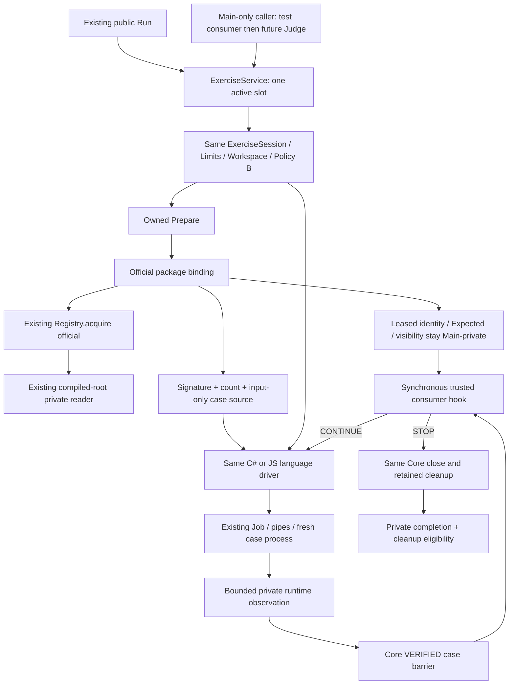

# Phase 9E-3 — Official Runtime Design

2026-10-25. **DESIGN APPROVED — E3-D1–D4 APPROVED. Phase9E-3 IN_PROGRESS — E3-S1.**
Only E3-S1 is implementation-authorized. Original survey/proposal statements below record the planning task; the dated approval/delivery record at the end supersedes their authorization status. Future-step descriptions remain planned scope.
Original planning-task evidence: source survey/design/implementation planning
only, without production code, Runtime execution, tests, build, profiling or
resource changes. S1 delivery is recorded separately at the end and in its report.
Phase9E-2 is **COMPLETE — PASS WITH LIMITATIONS**, formally accepted separately;
its data acceptance is not Official Runtime or release certification.

## Tóm tắt bài toán

Make the existing Learning Runtime consume a Main-private ordered Official Case
Plan and provide truthful private execution evidence to the later Judge, while
preserving public Run and the single admitted operation/cleanup lifecycle.
9E-3 supplies execution capability and a decision hook;9E-4 supplies comparison,
verdict reduction and Judge policy. Submit IPC/UI, Accepted/Failed Storage and
History remain later phases. No Official execution port currently exists.

Authority: [Requirements](REQUIREMENT.md), [Architecture](ARCHITECTURE.md),
[Decisions](DECISIONS.md), [Codebase Map](CODEBASE-MAP.md),
[Language Support](LANGUAGE-SUPPORT.md), [overall plan](IMPLEMENTATION-PLAN.md),
[approved Judge/Submit scope](PHASE-9E-JUDGE-SUBMIT-DESIGN.md),
[A/B/C policies](DECISIONS.md),
[9E-1 closure](PHASE-9E1-FINAL-ACCEPTANCE.md),
[9E-2 handoff](PHASE-9E2-FINAL-ACCEPTANCE.md). E2-D1–D5/M1=A, ADR-025,
9E1-L1–L12, S5-P2 and9E1-AC1/S5-AC1 remain binding. The specific private types,
module seams, hook contract and staged rollout below need approval; no accepted
decision is reopened or silently amended.

## Mục tiêu và tiêu chí thành công

**Fact — approved goal:** reuse Runtime9D, Case-source refactor, private settled-case
hook, richer C# evidence and unchanged Run wrappers. An Official operation uses
one Prepare, one compile/syntax attempt, sequential fresh case processes, required
VERIFIED barriers and the same Core close/recovery path. No second session,
admission slot, queue, process manager, Registry or cache.

**Proposed acceptance:** both languages consume exact pinned Official inputs without
Expected/visibility in their execution descriptor; preserve all six types and
order; make private evidence distinguish transport failure from a trusted harness
failure; retain first trusted deadline/quota cause and cleanup eligibility; prove
Run/Official exclusion and no private publication. Verify a representative pilot
before authorizing the all63 bridge screen. A passing bridge screen does not close
the12 performance models or certify all target machines automatically.

## Thông tin đã biết — current-state architecture

The findings below are **Fact from source inspection**, not new execution evidence.
Existing comments saying a feature is “future/declarations only” are not used as
implementation status when the code below supplies that feature.

| Actual owner / path and symbols | Implemented behavior |9E-3 gap / reuse boundary |
|---|---|---|
| [exercise-package-resources.ts](../src/main/services/learning/content/exercise-package-resources.ts), `openAnchoredExerciseResources`, `ExerciseResourceRoot.package/publicPackage` | Compiled-root manifest admission, contained exact assets, bounded reads, lengths/SHA, canonical signature hash, metadata/Judge/path/version linkage; separate public read | Reuse unchanged; Official binding must use the runtime compiled-root Registry, never an unanchored source/staging reader |
| [exercise-package-validation.ts](../src/main/services/learning/content/exercise-package-validation.ts), Judge validator | Full schema, six types, arity, unique per-set IDs, public sample prefix/hidden linkage, versions/comparator and L1–L12 | Reuse unchanged; validation is not a runtime driver or release certificate |
| [exercise-package-registry.ts](../src/main/services/learning/content/exercise-package-registry.ts), `acquire/acquirePublic`, lease/copy/representation/invalidate/stop | One slot/flight/pin, capability/owner identity, registered derived work and budgets; `acquire` requires owned Prepare; readiness never asserts Judge/Submit/release-ready | Reuse; no Official-to-language execution binding yet |
| [package-run-binding.ts](../src/main/services/learning/package-run-binding.ts), `packageRunBinding` | During admitted Prepare: `acquirePublic`, public projection, reserve two logical representations, instantiate legacy adapter; release after Core cleanup and execution settle | Public samples only. Not an Official port. Its captured Prepare-deadline guard cannot be copied unchanged for later per-case derived work |
| [exercise-service.ts](../src/main/services/learning/exercise-service.ts), `run/createWindowsExerciseService`, Operation, observation/publish/cleanup | Owner/frame-generation coordination, one active operation/no queue, recovery, same-session orchestration, cleanup retention; factory composes only sample adapters | Need a Main-only Official admission variant in this same owner; public Run request/DTO cannot select it. Fixed `WindowsExerciseDriver` injection is a controlled-test process port, not a product Official API |
| [exercise-session.ts](../src/main/services/learning/runtime/exercise-session.ts), `claimOrchestration/runPhase/verifyExecutionBarrier/close` | One orchestration claim for exact adapter, phase order/quotas, retained tasks/barriers, first cancellation, checkpointed Policy B cleanup and retry | Reuse Core semantics; new driver must use its exact adapter identity, not claim a wrapped/delegate mismatch |
| [exercise-limits.ts](../src/main/services/learning/runtime/exercise-limits.ts), `ExerciseLimits` | Single monotonic operation timer, phase min(operation deadline, phase deadline), late-result checks;12s caller wait never abandons underlying cleanup | Reuse unchanged. No Judge timer or timeout refunds |
| [csharp-execution-adapter.ts](../src/main/services/learning/runtime/csharp-execution-adapter.ts), `WindowsCsharpExecutionAdapter` | Clone catalogue Exercise; count/args from samples; prepare/compile once; per-case artifact/runtime revalidation and new process; bounded prefix/suffix/failure reserve | Decouple signature/inputs from samples. Current malformed/nonzero response collapses to RUNTIME_ERROR; harness error subtype is lost |
| [csharp-harness.ts](../src/main/services/learning/runtime/csharp-harness.ts), `generateCsharpHarness`; [csharp-compiler.ts](../src/main/services/learning/runtime/csharp-compiler.ts) | Typed generated call, local Roslyn/reference closure, fixed environment/exclusive files and runtime selection; harness generation requires sampleCount=Exercise.samples.length | Keep Roslyn/SDK/workspace/ABI behavior; extract signature/count generation seam without changing legacy Run wrapper/signature policy |
| [javascript-execution-adapter.ts](../src/main/services/learning/runtime/javascript-execution-adapter.ts), `WindowsJavascriptExecutionAdapter` | Samples-derived schema; PATH-first stableNode24 probe in Prepare; parse-only syntax; per-case harness/runtime revalidation/fresh process; explicit PROTOCOL_FAILURE | Decouple input source. Preserve resolver/probe, quotas, strict protocol and snapshot reserve |
| [javascript-harness.ts](../src/main/services/learning/runtime/javascript-harness.ts), `FixedJavascriptHarness`; [javascript-harness-child.mjs](../src/main/services/learning/runtime/javascript-harness-child.mjs) | Fixed identity-verified child; separate source JSON containing code/function/schema, no Expected; requests read sample args; six types/strict bounds/valid failure response | Change signature/count/request source seam only; no student evaluation in Main or package execution |
| [csharp-orchestrator.ts](../src/main/services/learning/runtime/csharp-orchestrator.ts), `runCsharpSamples`; [javascript-orchestrator.ts](../src/main/services/learning/runtime/javascript-orchestrator.ts), `runJavascriptSamples` | Same Core, fresh process per sample, prefix/suffix, fail-fast runtime failures. C# has post-compile/per-case barriers; JS also needs post-Prepare probe barrier | No consumer decision between a successful case/barrier and next case. Preserve language-specific barrier schedule |
| [windows-exercise-adapter.ts](../src/main/services/learning/runtime/windows-exercise-adapter.ts), native result port | Suspended launch/input/quota-readback/resume; raw bytes before decoding; retained descendant identities, pipes/process settlement; native Job-memory evidence | Reuse; no native/ABI/quota/monitor cadence or SDK concurrency redesign proposed |
| [exercise.ts](../src/shared/contracts/exercise.ts), [exercise-validation.ts](../src/shared/contracts/exercise-validation.ts) | Public Run request exactly exerciseId/language/code/sourceRevision; public snapshots include C#/JS actuals/console; no official flag/inputs/Expected | Keep public contracts unchanged; Official evidence must never pass through this DTO just because it validates structurally |
| [exercise-ipc-service.ts](../src/main/ipc/exercise-ipc-service.ts), [exercise bridge](../src/preload/bridge/exercise.ts), [composition](../src/main/index.ts) | Main authorizes document/context, public snapshot allowlist, current publication routing and disposal; service before Registry managed shutdown | No Submit/Official IPC. Existing routing must explicitly exclude private operation kind if the same service gains that kind |

**Fact — public cap conflict:** [practice.ts](../src/shared/contracts/practice.ts)
`isExercise` permits1–16 samples. Official NextDate has17 cases, DigitCount21.
Constructing a fake public Exercise with Official cases fails this contract and
mixes hidden data into a public shape. Do not raise the public sample cap, attach
Official Expected to a catalogue record or bypass `isExercise` with a cast.

**Fact — data prerequisite:**9E-2 release7 has63 full packages/504 cases
(126 public/378 hidden),789 static witnesses,206 correctness+126 broader kills;
12 critical performance models remain pending. Root manifest64861 bytes/SHA256
`75ddbf0447e4708882c1e8e1f96e7cbebf97bf5aa170a14713e96755a9d3e081` and
compiled anchor match in accepted evidence. Reading this evidence adds no timing,
memory or new correctness claim.

### Implemented / missing / downstream dependency split

- Implemented/reusable: full data/reader/Registry/parser/budgets, public Run, both
  language runtimes, Core/native ownership/deadlines/recovery/cleanup.
- Missing/in9E-3: private input-only case source/signature/count integration,
  private admission/completion segregation, consumer stop/continue hook,
  truthful private C# protocol observations and owned plan-to-driver wiring.
- Depends on9E-3:9E-4 comparison/verdict/fail-fast WA;9E-5 persistence eligibility
  after VERIFIED cleanup;9E-6 submission UI/history;9E-7 full release matrix.
- Not9E-3: Generic Judge policy/comparator, Submit IPC/UI, Accepted/Failed storage,
  completion, History, Project/PTY/Monaco features, public custom tests,
  formatting/debugging, runtime selection redesign or performance-limit changes.

## Giả định

1. **Assumption:** a Main-only integration/test consumer may exercise the proposed
   port before9E-4 exists. No production Submit caller is installed. If approval
   excludes that consumer, keep native bridge execution blocked until a separately
   authorized consumer is available; do not invent Renderer testing IPC.
2. **Assumption:** the fixed harness v1 envelopes remain sufficient: both languages
   already carry USER_EXCEPTION/INVALID_RESULT and caseIndex. Source inspection
   supports this, but real private-evidence compatibility needs S2/S3 tests.
   If evidence requires a wire-version change, stop and propose it explicitly.
3. **Assumption:** retained bounded prefixes remain feasible for current sets.
   Only static Expected-envelope estimates exist; actual console/escaped output
   may hit1MiB. Do not silently replace retention with streaming or refund bytes.
4. **Assumption:** installed Windowsx64 SDK10.x/Node24/native ABI can be used in
   later authorized integration. Missing host/SDK/native evidence is SKIP or
   UNVERIFIED, not a pass. No download/install or target-host inference here.

## Câu hỏi quan trọng

No missing fact blocks producing this design. E3-D1–D4 below need user approval
before implementation; approval of this planning task does not resolve them.
The known count cap is an integration seam, not evidence that60s is impossible.
No empirical feasibility decision is made without execution evidence.

## Các phương án

**A — Recommendation: one input-driven language implementation, compatibility
wrappers for Run.** Introduce Main-only signature/case-source/evidence contracts;
let the same C#/JS runtime internals consume either a public sample source or a
pinned Official input source. Share orchestration mechanics with a private hook.
Strongest protection against divergent quotas/cleanup; moderate refactor and
focused Run parity risk. Public constructors/wrappers/DTO mappings remain stable.

**B — Separate Official adapter facades over the same compiler/probe/native/Core.**
Leave sample adapters intact and add Official adapters in Main. No second
operation/Registry, but request/result/phase/budget logic is duplicated or must
be extracted anyway. Smaller initial Run surface; more long-term divergence and
larger lifecycle/protocol test matrix. Viable only if A cannot preserve legacy
mapping without broad changes, with a separately reviewed concrete scope.

Rejected shortcuts: fake public Exercise (16-sample cap and leakage); repeated
sample Runs (multiple operation/deadline/reset semantics); a second Runtime or
generic executor (ownership/security conflict); batching cases in one process,
new concurrency/cache/worker or the NOT PASS SDK prototype (unapproved policies).

## So sánh trade-off

| Criterion | A: input-driven reuse | B: separate Official facades |
|---|---|---|
| Maintenance | One set of phase/byte/cleanup rules | Duplicated rules or equivalent extraction later |
| Existing Run risk | Explicit wrappers/parity tests required | Smaller initial adapter diff, shared dependencies still tested |
| Main-private isolation | Separate contracts and operation kind required | Separate contracts and operation kind still required |
| Complexity | Moderate scoped extraction | Moderate initially; higher cross-language drift burden |
| Performance | No speed claim; same fresh-process/barrier semantics | No speed claim; same immutable budgets |
| Conditions to choose | Preferred if bounded refactor passes compatibility gates | Only if an evidenced A blocker warrants further approval |

## Giải pháp đề xuất — proposed architecture

### A. Main-private ownership and data flow

The private branch has no route to public `onSnapshot`, Exercise IPC, Preload or
Renderer. The future Judge may join Expected to the current returned observation
inside Main; the language adapter/child does not receive Expected or visibility.
Run keeps its existing public-only acquisition and observations.

### B. Official Case Plan and Registry lifetime

**Proposed module seams**, not existing ports:

- `src/main/services/learning/official-case-plan.ts`: a narrow leased binding,
  using existing Registry `acquire` during owned Prepare. No filesystem reader,
  new cache or per-exercise algorithm. Capture immutable identity
  exerciseId/packageVersion/testSetId/version/JudgeSHA/signatureVersion+hash,
  ordered parameter names/types, return type and comparator identity.
- `runtime/execution-plan.ts`: Main-only input descriptor with signature, bounded
  caseCount1–128, and an index-checked input source. Keep case IDs/visibility,
  sample linkage and Expected only on the private Judge-side view. Its constructor
  takes a validated full lease, not a raw path/JSON/renderer descriptor.
- `runtime/official-execution-contracts.ts`: private observation/completion/hook
  contracts. Reuse existing type primitives, native observations and cleanup
  facts; do not export these from the public shared contract index.

Full reader/validator remains the single authority for raw hashes, exact schema,
signature, version, arity, case IDs, types and public-prefix linkage. A source
file or renderer-provided hash cannot replace compiled trust. Registry structural
readiness remains distinct from runtime/release readiness; no new flags become
true merely because acquisition succeeds.

**Proposed memory/lifetime choice:** hold the validated immutable lease/aliases,
not a structured clone of the complete Official package inside each adapter.
Prepare only the fixed signature/count/harness data; serialize the current input
inside that case's execute budget. Register actual package-derived clones and
request representations through existing lease accounting where retained. Do not
collect504 cases into one operation or a second global plan inventory/cache.

Owner binding uses the existing service owner-entry/generation and exact admitted
operation token, not hardcoded shared owner IDs or Renderer revision authority.
Acquisition remains phase='prepare'. **Important:** subsequent registered derived
work must check the *current Core phase* signal/deadline; a closure over the
original Prepare deadline would incorrectly reject later cases. No operation
clock reset, I/O before admission or fresh10s allowance on later reads. Owner
validity, runtime cancellation and content-retention eligibility are distinct:
normal Core close cancels phase work, but does not permit forgetting pending
package work or prematurely unpinning data. No new derived work after close.

Retain every started Registry task, even when a phase/caller times out. Invalidate
on actual owner/context/shutdown loss; no late publication. `releaseContent`
remains a single service-controlled action only after execution has settled,
required Core cleanup is VERIFIED/complete and package tasks/borrows have settled.
Under unresolved cleanup, retain the lease and active slot; retry cleanup resumes
the same work. Captured identity and bounded execution observations can outlive
case reads under the same owned completion handoff; no naked borrowed Expected
reference may escape its lease. Future storage hold-through-commit is9E-5 work,
not implemented as part of this lifetime refactor.

Package raw/canonical/node/derived-plan limits and Runtime raw/result-prefix
limits remain separate existing budgets. Do not send arbitrary student actuals
through an asset parser merely to account them: that could impose new asset
shape/node caps on otherwise valid runtime responses. Document every retained
alias/clone/string/result representation and prove its existing owner/ceiling;
if current primitives cannot account a required new package-derived object,
stop S1 for a narrow proposal rather than add a ledger or waive accounting.

### C. Same admission and private publication boundary

Propose an internal operation-kind discriminant and a Main-only Official entry
in `ExerciseService`, sharing its existing admission routine/active slot,
owner/generation recovery guards, workspace/session factory, stop/invalidation
and cleanup. This is not a new service or public `official` request flag.
Factory configuration remains synchronous; acquisition/probing only starts after
Core admits Prepare. `ExerciseSession` stays the lifecycle owner.

The private entry returns an owner-bound Main-only handle/completion; a future
Judge or controlled integration consumer can use it. No production Submit caller
is installed in9E-3. Public `run/snapshot/completion/stop` keep their documented
Run behavior, reject Official references, and never expose its raw snapshots or
results. Official operations do not populate public `last` results/publication
routes. The public branch must not get hidden actual/console/diagnostics even if
an Official observation happens to satisfy `validateExerciseSnapshot`.

Suppress the private branch *before* `onSnapshot`/IPC routing, not only by a
redaction heuristic downstream. Core snapshots may contain compiler text and are
private while Official mode runs. Invalidation and managed shutdown still act on
the same active operation, independent of whether it has a public route. Preserve
one Run-or-Official operation, no queue, no implicit replacement and recovery
admission closure. Future safe aggregate Submit DTOs belong to9E-4/6.

### D. C# and JavaScript integration

| Concern | C# proposal | JavaScript proposal |
|---|---|---|
| Input seam | Generate harness from trusted signature/count, requests from input source; compiler no longer needs a full Exercise for Official mode | Fixed harness source JSON needs code/function/schema only; request uses private source rather than samples |
| Run compatibility | Keep legacy constructor and `generateCsharpHarness(Exercise,schema)` wrapper validating sample agreement and delegating the common input implementation | Keep legacy samples constructor, FixedHarness wrapper and public schema/result shape |
| Prepare | Same installed SDK10.x discovery, runtime-file capture, validate admitted inputs; no NuGet/MSBuild/cache/concurrency | Same PATH-first stableNode24 identity/probe inside Prepare10s/512MiB; verify post-Prepare barrier |
| Compile | Same direct Roslyn/explicit references/2GiB/exclusive workspace and fixed flags; compile once | Same parse-only syntax child/30s/2GiB, never execute top-level source during syntax |
| Execute | Fresh dotnet exec per case, artifact+runtime revalidation, one stdin document, original2s includes startup/revalidation/parsing | Fresh Node child per case, source/harness/node revalidation, one request, original2s |
| Evidence gap | Retain valid harness USER_EXCEPTION/INVALID_RESULT separately from malformed transport/host failure; preserve old Run mapping | Preserve existing PROTOCOL_FAILURE and additionally retain trusted failure subtype privately |
| Cleanup | Same compiler+execute Jobs/observers/descendant identity evidence | Same Prepare-probe+syntax/execute Jobs/observers/descendant evidence |

Use six existing types: int32, boolean, string, int32[], string[], int32[][].
Exact arity/index/order and valid Unicode, rectangular dense matrix semantics
remain. Valid wrong-sized rectangular output is a valid returned value for the
future Comparator, not a protocol failure because it differs from Expected.
No type coercion, sorting or authoring-domain checks on arbitrary student output.
Public samples remain≤16; Official count remains≤128 under its *private* schema.
Internal compatibility mapping may retain v1 harness field names such as
sampleCount; that does not make an Official plan a public SampleSchema/Exercise.

### E. Private observation and protocol boundary

Propose private evidence retaining: language/phase/caseIndex; returned typed
actual **or** valid harness USER_EXCEPTION/INVALID_RESULT **or** protocol failure;
trusted process-exit/pipe-settlement/quota/deadline facts; compile/syntax attempt
and existing bounded diagnostic attribution; attempted prefix/unattempted suffix;
driver disposition (exhausted/consumer-stop/execution-failure/invalidated), plus
Core cleanup facts. These are observations, never Accepted/WA/storage outcomes.

C# already emits valid FAILED envelopes with error subtype. Its Main parser
currently uses JSON.parse plus the public validator, while JS has a strict
duplicate/depth/single-document pre-scan. **Recommendation E3-D3:** extract/reuse
the existing bounded protocol JSON kernel with neutral naming for Main-private
C# response admission, preserving JS semantics; do not create a second parser,
use package-asset ceilings for arbitrary actuals, or silently strengthen public
C# Run's compatibility contract. Keep public wrappers/error mapping; private
classification has its own validator. No wire v2 is proposed. Extraction must
pass existing JS protocol regressions and C# public mapping tests before use.

Reject invalid UTF8/BOM, duplicate decoded keys, wrong index/version, missing/
extra fields, malformed/multiple documents, invalid typed actual and unexpected
physical stream/exit inconsistencies as private protocol/infrastructure evidence
according to trusted facts. Preserve C# valid FAILED exit0 versus JS FAILED exit1;
do not copy JS's exit rule to C#. Nonzero exit alone is not proof of user exception;
unknown launch/observer/protocol failures stay untrusted. Runtime OOM text is not
Job-memory proof. Existing source/signature compile errors and safe diagnostics
are preserved; a diagnostic located in generated harness code is not alone proof
of a trusted-harness defect or student fault. Ambiguous attribution is handed to
the later Judge as ambiguous, not guessed here.

The accepted process boundary is not a malicious-code OS sandbox. A parsed
student-accessible protocol is not cryptographic result authenticity; no new
secrecy/authenticity claim is made by this proposal.

### F. Settled-case hook, ordering and stop

Recommend a synchronous trusted Main consumer hook returning CONTINUE or STOP,
invoked only for an indexed successful RETURNED case after the required VERIFIED
barrier. Check the same operation limit and current owner immediately before and
after the hook and before any next launch. Reject an invalid/Promise return or
thrown hook as infrastructure, with same-session cleanup. No I/O/new timers or
asynchronous comparator lifecycle hidden in the hook. Future pure Main comparison
is a9E-4 consumer;9E-3 tests can request STOP without implementing equality/WA.

Core/language failures stop the driver without a continuation hook. Private final
failure evidence is consumable with its actual cleanup status; a settled pipe
record is not a VERIFIED-cleanup proof. Normal STOP preserves a genuine untouched
suffix and calls the same `close('COMPLETED')`; it does not forge RUNTIME_FAILED,
WA or all-cases-pass. The private disposition distinguishes consumer-stop from
exhaustion, and neither is a Judge verdict. Closure never relaunches cases on retry.

Keep language-specific existing barriers: C# after compile and each successful
execute; JS after Prepare probe, syntax and each successful execute. One shared
driver loop may have explicit fixed language stages, not per-exercise branches.
Always claim orchestration on the exact binding object passed to the session.
Native Jobs/handles remain retained until existing Policy B final disposition;
a case barrier is not a release/finalization or a fresh deadline grant.

### G. Error, timeout, cancellation and cleanup semantics

| Observed fact | Private9E-3 meaning / obligation | Later concern, not implemented here |
|---|---|---|
| Missing/corrupt package, bad binding/signature, missing/incompatible runtime | Safe infrastructure/dependency cause, no sample fallback | Judge decides safe failure display; no student grade inference |
| Failed compile/syntax attempt | Preserve status/exit/safe diagnostic attribution |9E-4 determines truthful grading versus trusted-asset/ambiguous failure |
| Valid returned actual | Typed data only; after barrier, hook may run | Equality/WA/Accepted in9E-4 |
| Valid harness USER_EXCEPTION/INVALID_RESULT | Runtime observation with retained subtype | Runtime Error verdict eligibility later |
| Malformed/duplicate/wrong-index/wrong-exit protocol | Protocol/infrastructure cause; public C# legacy mapping unchanged | Never fabricate a graded failure record |
| Core phase/operation expiry | Preserve first trusted cause/phase/case; late success cannot win | Future TLE reduction uses these facts |
| Native Job limit / raw/envelope overflow | Quota/output cause from accounting; no refunds after redaction | Future MLE/OLE reduction |
| Owner/context loss or shutdown | Suppress private/public publication, cancel, retain cleanup | Not WA and no history |
| HISTORY_UNVERIFIED / PROCESS_UNRESOLVED / cleanup caller timeout | No final eligibility; retain current resources/tasks/slot and resume exact cleanup | No Accepted or commit; later UI/storage classification |

Core60s covers execution phases/barriers and consumer decision secured before
close. Existing final cleanup wait12s is per caller; it does not kill/forget the
retained cleanup task or promise60s end-to-end storage. Policy B/checkpoint/recovery
behavior is not rewritten. No second AbortController selecting a competing
semantic timeout; trusted Core first-reason handling remains authoritative.

### H. Feasibility: evidence versus hypotheses

**Fact — accepted static data:** one operation selects one of63 sets (3–21 cases),
not all504 cases together. Full registry2179471 raw bytes/316 files; largest Judge
331652 raw/110861 canonical bytes; max Judge nodes20086. Existing package limits:
manifest4MiB/4096 packages, Judge4MiB/package6MiB/registry256MiB; resident package
proxy16MiB/1m nodes/raw8MiB, including retained package plans/clones. Max admitted
request60043 bytes; synthetic response13595, aggregate14361. Empty-console estimates
are not actual execution output/envelope or physical memory measurements.

**Fact — immutable Runtime:** Prepare10s; compile/syntax30s/2GiB; execute2s/case
including startup/512MiB; operation60s; aggregate physical stdout+stderr1MiB;
bounded retained result/envelope and existing failure reserve (public factory
currently reserves4096 extra bytes); one operation/no queue;12s caller cleanup wait.
Private retention cannot remove legacy byte guards just because nothing is sent
to Renderer. Specify and test a private envelope reserve before rollout.
Prepare probes and compiler/syntax output also consume the existing aggregate
raw budget; it is not reset at the start of each case. Fresh-process isolation
does not mean per-case handle/history release: retain native evidence until the
existing operation cleanup can safely dispose it.

**Hypothesis to verify:** removing samples coupling and retaining aliased plans
is feasible without policy changes. Source inspection does not establish real
process startup/SDK/AV/pipe/cleanup cost or guarantee any particular set fits.

| Known flag | Static budget observation | Required later evidence |
|---|---|---|
| DigitCount21 |10+30+2N=82s;20/N≈0.952s after worst-case Prepare/compile alone | Early both-language pilot; original60s stays.82s is a sum of ceilings, not measured minimum latency |
| NextDate17 / Reshape13 |74s/66s ceiling sums;≈1.176/1.538s per case under the same arithmetic | Real whole operation, inputs/output, barriers and cleanup; no witness deletion |
| SearchRotated/TrappedWater/Candy12, MaxRectangle11, EditDistance11, MinimumHealth10 |64/62/60s ceiling sums before unmeasured hook/barrier work | Include in rollout risk rows; do not label impossibility or feasibility from these sums |
| Max-size arrays/matrices, console/protocol expansion | Expected envelopes are small relative to1MiB; arbitrary actuals/console may exhaust it | Test cumulative raw budget, encoded private prefix and later-failure reserve; valid wrong shape remains distinct from malformed type |
| SDK discovery / runtime identity / AV or file locks | Historical PREPARE_TIMEOUT cause/reliability unresolved | Record observed failure; do not enable NOT PASS concurrency prototype or unrelated optimization work |

The12 exact pending models remain: Fibonacci uncached-recursion; LongestPath
uncached-dfs; PrimeCount trial-all-lower-divisors; EditDistance and SubsequenceCount
uncached-recursion; quadratic MaxProfit/MaxSubarray/FirstMissingPositive/
TrappedWater/Candy; MaxRectangle enumerate-scan-all-rectangles; MinimumHealth
uncached-path-enumeration. Their fixed IDs/names/witnesses are retained in the
[9E-2 final register](PHASE-9E2-FINAL-ACCEPTANCE.md). They are not12 measured TLEs
or12 detected correctness mutants.

If real complete-set evidence fails a deadline/budget, preserve the failure and
stop the affected acceptance. Options to present then: retain this package as
Runtime-unverified and block its release while investigating a narrowly approved
implementation defect; investigate an approved-equivalent existing-semantics
efficiency fix; or submit a separately authorized requirements/ADR change if the
contract truly cannot fit. None authorizes new coverage, quotas, concurrency,
batching or execution semantics here. No proved contract infeasibility was found
by read-only inspection; empirical feasibility remains UNVERIFIED.

## Phạm vi MVP và rollout đề xuất

- **Bắt buộc có:** leased input-only plan, both language seams, richer private
  evidence, post-VERIFIED decision hook, same-service exclusion/cancel/cleanup,
  no public publication, Run compatibility and representative proof.
- **Nên có:** case-level phase/raw-byte/cleanup observations in bounded private
  test receipts with source/package identity; static limits and actual completion
  counts clearly separated. No new production telemetry/benchmark framework.
- **Làm sau trong9E-3, chỉ sau pilot acceptance/authorization:** one whole-operation
  bridge screen for each63 exercises×2 languages, plus explicitly scoped pending
  model fixtures where authorized. This is not the release repeat/target matrix.
- **Không nên làm trong9E-3:** comparator/verdict/Submit/store/history or UI,
  streaming-result redesign, second cache/lifecycle, package/case modifications,
  quota changes, SDK prototype promotion or target-host certification by assertion.

Proposed representative pilot is eight IDs: ch2-04 Divide, ch3-04 LeapYear,
ch3-07 Ticket, ch5-03 CommonPrefix, ch5-07 MinWindow, ch7-01 TwoSum,
ch8-01 Reshape, ch4-03 DigitCount. It spans every six-type input/output category,
mixed arity, strings/arrays/matrix, approved M1 semantics and21-case headroom.
Run each full frozen set in both languages; no prefix-only Official claims.
Failed/timeout operations remain truthful partial evidence with real suffixes.

### Implementation selections — E3-D1–D4 APPROVED by user (2026-10-25)

| ID | Recommendation requiring user approval | Does not authorize |
|---|---|---|
| E3-D1 | Option A input-driven adapter refactor + Main-only Official entry on existing ExerciseService; public Run contracts/routing unchanged; same active slot, generation and content lifetime | Submit IPC/UI, second admission/service/Registry or private data in shared DTOs |
| E3-D2 | Aliased leased Official plan/current-input serialization; retained bounded runtime prefix; synchronous post-VERIFIED CONTINUE/STOP hook, deadline checks and explicit private disposition | Comparator/WA, asynchronous hook lifecycle, unaccounted package clones, output guard removal or streaming redesign |
| E3-D3 | Main-private evidence retaining C# protocol/harness distinctions; reuse extracted existing protocol JSON kernel, v1 envelopes and legacy Run mapping | New wire version, raw private public fields, new parser policy or guessed student blame |
| E3-D4 | Six-step plan, eight-ID two-language pilot; separate acceptance before63×2 bridge screen; pending runtime models and release matrix stay separately classified | Automatic next-step implementation, forced performance PASS or9E-4 start |

## Rủi ro và dependencies còn mở

| Risk | Early failure signal | Mitigation / gate |
|---|---|---|
| Official results leak through existing public snapshots | Private actual/console reaches onSnapshot/last/IPC | Discriminated internal operation, public routing rejection and sentinel tests before native pilot |
| Wrong owner/deadline during leased case work | Prepare expires while later valid cases run, or late tasks publish | Live Core-phase guard, retained tasks, cancellation race tests and zero ledger after true cleanup |
| Count/shape compatibility regression |17/21 cases rejected or wrong-sized valid return called protocol failure | Separate private count schema; no fake Exercise; six-type/shape and Run parity tests |
| Duplicate/exit/protocol handling incorrectly grades student | C# valid FAILED versus malformed response conflated | Private parser/kernel reuse, exit rules per language; preserve ambiguous attribution for9E-4 |
| Consumer decision races timeout/cleanup | Next case launched after STOP or operation expiry | Synchronous bounded hook, Core checks before/after, no new launch after stop, retained close |
| Prefix/serialization overhead or native startup exceeds limits | OLE/timeouts despite small static Expected estimates | Scoped full-set evidence, original budgets/reserves, stop affected acceptance; no silent optimization/coverage change |
| Broader release evidence absent | Current host passes but B1a/B1b/installed cells absent | UNVERIFIED under9E1-AC1/S5-AC1; full9E-7 release matrix still required |

Historical FAILs/SKIP/LF-CRLF/PREPARE_TIMEOUT/reliability/RSS-stall/reparse/offline
limits remain in9E-1/9E-2 reports. B1a Windows10x64/2 physical cores/8GiB/SSD and
B1b Windows11x64/≥4 physical cores/16GiB/SSD remain mandatory before9E-7 release.
This design has no new measurements or host claims.

Documentation availability limitation: several historical9E-0/9E-2 reports,
including the authoring design and Pilot/Wave reports, disappeared from `docs/`
during this task after relevant material had been read. No agent deletion or
restoration was performed. Current Decisions/Requirements/Architecture,9E-1 and
9E-2 final packets and the two new planning documents remain available. Treat
missing historical links as unavailable, not freshly verified; preserve the
concurrent deletion and ask the user for archive location/restoration intent.
The missing authoring-design file was not recreated to update its status.
Document QA passed for nine changed/new documents' whitespace/fences/statuses,
all39 local links in the two new planning documents and scoped git diff --check
(exit0; existing LF→CRLF notices retained).44 unique legacy link targets in
retained documents remain missing, combining prior gaps with the concurrent
removals; this is not reported as a passing historical-link gate. No application
verification or runtime experiment was executed.

## Bước tiếp theo và stop gate

**Recommendation: Plan approval**, using the companion
[9E-3 Implementation Plan](PHASE-9E3-IMPLEMENTATION-PLAN.md). Approve/revise
E3-D1–D4 and then separately authorize a specific first work package. All six
steps remain NOT_STARTED; design approval alone must not auto-start them.
No high-impact fact is guessed to force implementation readiness.

**Phase9E-2 COMPLETE — PASS WITH LIMITATIONS. Phase9E-3 NOT_STARTED — DESIGN
PROPOSED. STOP for user review; no production implementation authorization.**

## User approval / E3-S1 delivery — 2026-10-25

The user **APPROVES the Phase9E-3 design, six-step plan and E3-D1–D4**, and explicitly authorizes **E3-S1 only**. This dated record supersedes earlier proposal/authorization statements without deleting history. **Phase9E-2 COMPLETE — PASS WITH LIMITATIONS; Phase9E-3 IN_PROGRESS — E3-S1; E3-S2–S6 NOT_STARTED.** Architecture approval is not advance permission for later implementation.

| Decision | Approved selection | Scope restriction |
|---|---|---|
| E3-D1 — APPROVED | A: input-driven adapter reuse; future Main-only admission on the existing ExerciseService | Public Run unchanged; no S1 admission or Official execution wiring |
| E3-D2 — APPROVED | Leased plan and existing accounting; synchronous post-VERIFIED CONTINUE/STOP hook | S1 establishes contracts/controlled lifetime tests only; no production consumer hook |
| E3-D3 — APPROVED | Existing strict JSON kernel extraction; private C# evidence; public mapping and wire v1 unchanged | Native/private response mapping and execution await S2/S3 |
| E3-D4 — APPROVED | Six steps; eight-ID pilot in both languages, accepted before expansion to63 | Each later step needs its own authorization |

[S1 acceptance](PHASE-9E3-S1-PRIVATE-CONTRACTS-ACCEPTANCE.md): implementation delivered **PASS WITH LIMITATIONS — awaiting user acceptance**. Main-private leased identity/input contracts, pure signature/harness seams and existing strict JSON kernel extraction only. No adapter execution, service admission, Core/Registry/native lifecycle or public IPC/DTO change. Preserve all12 PENDING_RUNTIME models, Official60s UNVERIFIED, historical failures/SKIP and deferred9E1 gates. STOP before E3-S2; no commit/push/merge.
